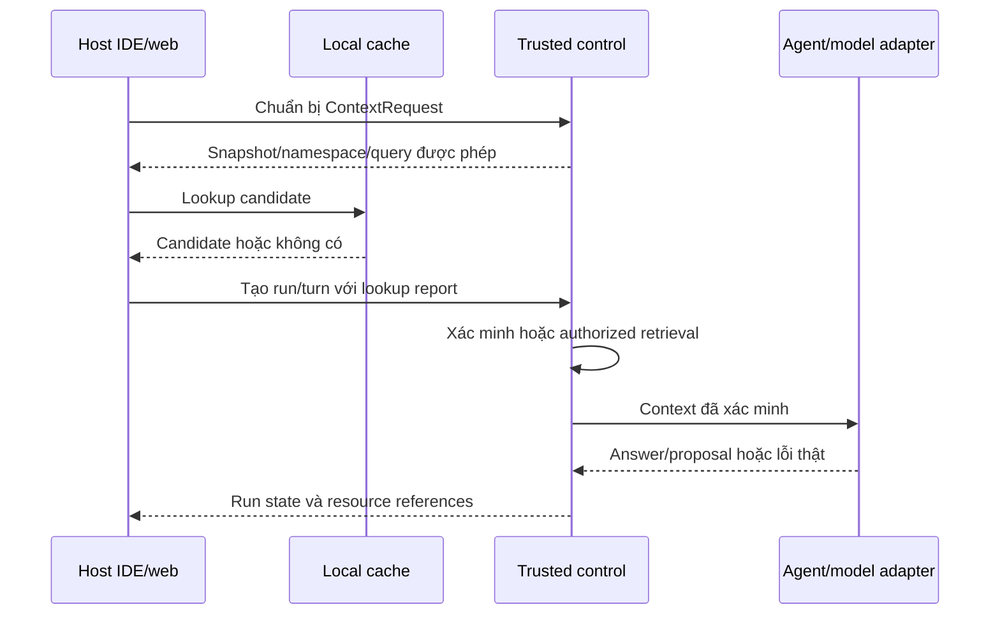

# Contract backend và cache — T02

## Trạng thái và phạm vi

**Đặc tả T02 v0.2 ngày 2026-11-07; đã triển khai ba thao tác tạo/danh sách/chi tiết báo giá, GET /health và GET /ready.** Các route validation/control/cache còn là thiết kế. API báo giá có entrypoint và quyền fixture riêng, được mô tả bên dưới; [domain/storage](architecture.md#lưu-trữ-báo-giá-đã-triển-khai) có migration riêng. Contract này cụ thể hóa [kiến trúc](architecture.md#bản-nháp-t02-module-và-contract), không phải SDK đã phát hành hoặc workflow Agent đang chạy. Các ví dụ JSON đều là dữ liệu giả minh họa, không phải fixture hoặc kết quả đo.

Đầu vào đã được người dùng chọn nằm tại [hồ sơ T01](../general/overview.md#hồ-sơ-đầu-vào-t01--đang-thực-hiện): sáu trường báo giá; ngày YYYY-MM-DD có thật và d >= 2026-11-07 trong fixture; Context Cache/browser trước; identity fixture backend quản lý; Developer được duyệt nếu có quyền Reviewer hiện tại. Acceptance vẫn chờ cô quy định, không mặc định 100%.

App báo giá và control có entrypoint/base URL riêng. Các route mới dưới đây dùng prefix đề xuất /api/v1; GET /health hiện tại giữ nguyên. Lõi cache chỉ phụ thuộc contract logic; HTTP, browser storage và model provider là adapter. Không tạo service riêng cho mỗi nhóm route.

Danh mục HTTP mô tả host web PoC; tích hợp lõi cache vào Agent/IDE khác không bắt buộc dựng ứng dụng báo giá hoặc toàn bộ WorkflowRun API. Host khác có thể dùng contract context/lookup/verify/admit/invalidate với adapter nguồn/quyền tin cậy tương ứng. Không đưa Quotation hoặc ReviewDecision vào kiểu dữ liệu lõi cache.

## Endpoint nền đã triển khai

Hai endpoint vận hành dùng path trực tiếp, không thuộc /api/v1 và chưa dùng envelope của workflow:

| Method/path | Response | Giới hạn |
| --- | --- | --- |
| GET /health | 200 với {"status":"ok"} | Chỉ process liveness, không mở kết nối DB |
| GET /ready | 200 với {"status":"ready","database":"ready"}; 503 với status = not_ready và database = not_configured/unavailable | Thực hiện PostgreSQL probe mỗi request; không trả DSN, exception hoặc credentials |

/ready hiện chỉ kiểm tra kết nối/truy vấn PostgreSQL, không chứng minh schema, quyền, model, cache hoặc workflow sẵn sàng. Thiếu extension vector không tự làm probe thất bại vì chưa có năng lực runtime cần extension đó. Adapter probe đọc version/extension để kiểm chứng qua test; endpoint không lộ metadata này. Cấu hình timeout và cách chạy ở [setup](../general/setup.md#2-backend).

## Kiểu và quy ước chung

| Kiểu | Định nghĩa dùng trong contract |
| --- | --- |
| Id | Chuỗi opaque do backend cấp; client không phân tích ID thành path/role/quyền |
| Revision | Số nguyên dương tăng khi tạo bản source/patch mới; không cho client ghi đè bản cũ |
| Digest | Chuỗi có tên thuật toán và giá trị digest; thuật toán, canonicalization và trust mechanism khóa tại T04. Ví dụ sha256 không phải lựa chọn thuật toán đã chốt |
| DecimalString | Chuỗi khớp toàn bộ `[+-]?[0-9]+(\.[0-9]+)?`, không exponent/whitespace/JSON number/NaN/Infinity; giữ nguyên precision và không làm tròn. Ràng buộc nghiệp vụ min/max/currency còn mở |
| JsonValue | Giá trị JSON bất kỳ: null, boolean, number, string, array hoặc object; JSON lỗi cú pháp vẫn là request lỗi |
| Timestamp | Thời điểm có offset, đề xuất biểu diễn UTC; tách khỏi ngày nghiệp vụ YYYY-MM-DD. Duration đo bằng đồng hồ đơn điệu, không suy từ hiệu hai máy |
| ConfigRef | ID/version của cấu hình đã đăng ký ở backend, không chứa API key, lệnh shell, raw policy hoặc endpoint provider do client tùy ý nhập |

Request không mang tenant/role/capability/approval state làm authority. API báo giá dùng Bearer fixture và grants tại [authorization](authorization.md#quyền-api-báo-giá-đã-triển-khai); principal/scope do backend gán. Mapping/freshness control/cache và masking theo resource vẫn chờ T04. GET /session bên dưới còn là thiết kế mô tả identity, không phải endpoint đã triển khai hoặc cách cấp quyền.

Response thành công dùng data và meta; meta có contract_version, request_id và các resource references liên quan. Error dùng error.code, error.message, error.details được phép lộ, cùng meta.request_id. Không trả nguyên exception, credential, absolute path hoặc source ngoài quyền trong details. Unknown measurements dùng null/not_applicable và coverage, không gán 0 giả.

## Dữ liệu ứng dụng báo giá

### HTTP báo giá đã triển khai

Entrypoint app.quotation_demo.main:create_app chạy bằng --factory, độc lập app.main/control; [cách chạy](../general/setup.md#2b-api-báo-giá-độc-lập). Các thao tác sau kiểm tra token/quyền ở đầu thao tác, trước mở transaction, kể cả replay:

| Method/path | Quyền | Thành công |
| --- | --- | --- |
| POST /api/v1/quotations | quotation.create | 201, data = QuotationRecord; bắt buộc Idempotency-Key |
| GET /api/v1/quotations?limit=50&after=UUID | quotation.read | 200, data = {items, next_cursor}; hết trang next_cursor = null |
| GET /api/v1/quotations/{UUID} | quotation.read | 200, data = QuotationRecord; không thấy trả 404 |

Response có meta = {contract_version: "v0.2", request_id, identity_mode: "fixture"}. X-Request-ID do backend sinh khớp meta; Cache-Control: no-store. Identity chỉ được kiểm tra cho dữ liệu báo giá; /docs và /openapi.json mở để xem contract, không chứa token/dữ liệu báo giá. Giao diện /quotations đã dùng ba thao tác này. App bật CORS theo allowlist QUOTATION_CORS_ORIGINS, chỉ GET/POST, nhận Authorization/Content-Type/Idempotency-Key và expose X-Request-ID, không dùng cookie credentials. CORS bọc cả response lỗi; origin được phép vẫn cần Bearer token/quyền.

Theo lựa chọn kỹ thuật của người dùng: body tối đa **65.536 byte (64 KiB)**, đếm cả bytes thực khi không có Content-Length; page limit từ 1 đến **100**, mặc định 50 (hoặc cap cấu hình nếu thấp hơn). Idempotency-Key từ **1–128 ký tự ASCII**, không trim/đổi hoa thường; client nên dùng UUID hoặc chuỗi in được để truyền qua HTTP. Giới hạn này không phải acceptance threshold nghiên cứu. Cấu hình chỉ cho phép hạ cap; không tự mở rộng giới hạn đã chọn.

Idempotency được lưu tại creation_requests, ràng buộc **principal + scope do backend gán + hash key** và hash payload chuẩn hóa. Thứ tự key JSON không ảnh hưởng; missing expires_on khác null, lexeme tiền khác nhau vẫn là payload khác. Cùng key/cùng payload trả lại record đã commit (201); cùng key/khác payload trả 409. PostgreSQL transaction/advisory lock đảm bảo retry song song chỉ tạo một record; tạo báo giá và metadata cùng commit, lỗi commit không trả thành công. Quyền luôn được kiểm tra lại trước lookup replay. Metadata chưa có TTL/GC hoặc API xóa, giữ đến khi có policy lifecycle riêng; hash ở đây dùng đối chiếu retry, không phải chứng thực cache/artifact.

Lỗi của ba thao tác dùng error = {code, message} và meta như trên, không echo input/exception/secrets:

| HTTP | Mã/trường hợp |
| --- | --- |
| 400 | INVALID_REQUEST: JSON/schema, UUID/cursor/page/key không hợp lệ hoặc thiếu key |
| 401 | IDENTITY_REQUIRED: thiếu/sai/thu hồi token, kèm WWW-Authenticate: Bearer |
| 403 | ACCESS_DENIED: identity hợp lệ nhưng thiếu capability |
| 404 | QUOTATION_NOT_FOUND: quyền đọc hợp lệ nhưng record không tồn tại |
| 409 | IDEMPOTENCY_CONFLICT: key cũ với payload khác |
| 413 | PAYLOAD_TOO_LARGE: body vượt cap |
| 503 | STORAGE_UNAVAILABLE hoặc AUTHORITY_UNAVAILABLE: dependency không xác minh/thực hiện được |
| 500 | INTERNAL_ERROR: lỗi lập trình không được giả thành lỗi storage hoặc thành công |

Không triển khai update/delete, validation hoặc expiration_review trong lát cắt này. POST thành công không xác nhận ngày hợp lệ, chưa tạo approval hay artifact.

### QuotationCreate và QuotationRecord

| Trường | QuotationCreate | QuotationRecord |
| --- | --- | --- |
| id | Không nhận từ client | Id do app cấp |
| supplier_name | string | string |
| description | string | string |
| total_amount | DecimalString | DecimalString |
| currency | string | string |
| expires_on | JsonValue, có thể thiếu trường | Giữ nguyên thiếu trường/null/giá trị JSON thô |

Năm trường nghiệp vụ được nhận khi tạo; id sinh phía server, nên record có đúng sáu trường đã chọn. Các trường ngoài contract như flags, approved, role hoặc artifact_digest không được nhận để thay kết quả/backend state. Ràng buộc nội dung chuỗi, giới hạn tiền tệ và danh sách currency là phần validation nền cần thống nhất trước T07, không bổ sung nghiệp vụ mới trong bước này.

expires_on không khai báo như một date đã parse tại HTTP/storage boundary. Thiếu trường khác null, khác chuỗi rỗng; không tự chuyển tất cả về null. Kiểu dữ liệu sai vẫn được giữ để validator xử lý khi ca đó thuộc fixture. Việc POST thành công chỉ xác nhận tiếp nhận record, không khẳng định ngày hợp lệ hoặc báo giá đã được phê duyệt.

Đề xuất parse của rule mới: chỉ chuỗi đúng YYYY-MM-DD và là ngày tồn tại được chuyển thành d; không tự trim khoảng trắng, ép số thành ngày hoặc chấp nhận timestamp như date. Mọi giá trị khác không phải ngày hợp lệ; d trước R cũng cần xem xét. R fixture = 2026-11-07. Chính sách cung cấp R ngoài fixture còn mở; client không được tùy ý đổi R của lượt thực nghiệm. Cách parse này cần đối chiếu oracle trước đóng băng fixture.

App nền chưa có rule mới phải tiếp nhận các đầu vào ngày tương tự; không cài trước việc kiểm tra expires_on dưới tên schema validation. JSON/mức payload không hợp lệ vẫn bị từ chối theo giới hạn T04, không cần lưu payload quá lớn để thử nghiệp vụ.

Ví dụ request/record, trong đó null là đầu vào cần thử sau khi bổ sung rule:

```json
{
  "supplier_name": "Nhà cung cấp mẫu A",
  "description": "Báo giá vật tư giả lập",
  "total_amount": "1000000",
  "currency": "VND",
  "expires_on": null
}
```

### QuotationValidation

Response có quotation_id, flags (mảng code/field/message), reference_date, validation_config_ref và active_artifact (id/digest). Cờ expiration_review chỉ xuất hiện khi code artifact đang chạy có rule và đầu vào không đạt điều kiện ngày; không phải request field hoặc approval state. Không có cờ này không có nghĩa mọi validation khác đều đạt. Response không chứa một boolean acceptance_passed khi ngưỡng nghiên cứu chưa được chọn.

Ví dụ riêng phần data sau khi artifact có rule được phê duyệt và kích hoạt; không phải output của backend hiện tại:

```json
{
  "quotation_id": "quotation-demo-01",
  "flags": [{"code": "expiration_review", "field": "expires_on", "message": "Cần xem xét ngày hết hạn"}],
  "reference_date": "2026-11-07",
  "validation_config_ref": "validation-demo-v1",
  "active_artifact": {"id": "artifact-demo-02", "digest": "sha256:aaaaaaaaaaaaaaaaaaaaaaaaaaaaaaaaaaaaaaaaaaaaaaaaaaaaaaaaaaaaaaaa"}
}
```

## Resource của control

| Resource | Trường chính dự kiến | Ràng buộc |
| --- | --- | --- |
| Session | principal_id, tenant_id, capability_refs, policy_ref, identity_mode = fixture | Chỉ backend xác định; capabilities phải còn hiệu lực ở mỗi thao tác |
| RepositorySnapshot | repo_id, snapshot_id, source_digest, file references, config_ref | Backend đọc nguồn được phép; snapshot của working tree phải có digest, không chỉ commit/branch label |
| ContextRequest | id, repo_id, snapshot_id, intent_ref, namespace_ref, query_fingerprint, cache_mode, embedding descriptor/vector khi cần, status, bound_run/turn refs | Gắn principal/scope/config/prompt và request; không tái dùng như quyền vô thời hạn |
| ContextBundle | context_id, payload, dependency manifest, payload_digest, namespace/config/embedding refs, thời gian và integrity/admission reference | Browser lưu candidate; backend xác minh toàn bộ trước dùng, mọi content GET kiểm tra quyền hiện tại |
| WorkflowRun | id, task_kind = inspect/change, context_request_id, source/config refs, status, phase, proposal references, context_resolution/lookup outcomes, usage/errors | Một tác vụ có thể có nhiều turn/lookup/model calls; không tính chúng như các workflow độc lập khi đánh giá |
| AgentTurn | id, run_id, prompt, context_request_id, expected_proposal_revision nếu đã có, status/result/error, attempt refs | Không đổi repo hoặc tự mở rộng scope của run; follow-up tạo revision mới qua executor khi cần |
| ProposalRevision | revision_id, proposal_id, revision, base_snapshot_id, source_digest, patch_digest, diff/source refs, artifact/test/binding refs khi sẵn sàng | Source/diff bất biến theo revision; artifact/evidence chưa có được ghi null, không giả Tested |
| TestRun | id, proposal/revision, artifact/fixture/suite/config refs, status, evidence_digest, results/timeout/error | Không nhận raw command; kết quả thuộc đúng artifact được thực thi |
| ChangeBinding | binding_id/digest; repo, proposal/revision, base/source/patch, artifact, test/evidence, fixture/suite/config và target refs | Server tạo từ records đáng tin cậy; approve/activate cần binding đầy đủ, không null |
| ReviewDecision | id, decision = approve/request_changes, actor, proposal/revision, binding ref nếu approve, acknowledged digest, reason, approval_id (null khi không approve) | Approve là hành động người có quyền; proposer và reviewer có thể cùng principal |
| Approval | id, decision_id, binding_id, effective_status = active/revoked/expired/superseded/unverifiable và policy reference | Bản ghi riêng của control; hiệu lực phải được kiểm tra hiện tại, không phải cache entry hoặc credential do client gửi |
| Deployment | id, binding_id, approval_id, target_id, expected_target_version, status, activated_artifact_digest, reason | Gate kiểm tra lại cùng bytes/digest khi kích hoạt; không rebuild hoặc suy từ branch name |
| TargetState | id, repo_id, version, active_artifact reference/digest và activation_status | Version từ control/launcher đáng tin cậy; cho phép client gửi expected_target_version, không tự ghi trạng thái target |
| Event | event_id/cursor, request/run/resource refs, actor, type, timestamp, outcome/reason, spans/usage khi có | Chỉ phát sinh cho hành động đã thực thi; code/log nội dung bị giới hạn theo quyền và retention |

ChangeBinding và digest phải ánh xạ tới dữ liệu backend thực, không được dựng bằng cách hash các metadata client tự khai. Thuật toán tạo binding, tính bất biến và kiểm tra nguyên tử tại activation thuộc T04. Hồ sơ DB/quan hệ và nơi giữ artifact bytes thuộc T03; các bảng ở đây là kiểu resource, không phải SQL schema.

### Request của context, run và turn

Ký hiệu dưới đây mô tả shape wire, không phải source TypeScript/Python đã được thêm. Dấu ? là trường có thể vắng mặt; Id/Revision/ConfigRef/JsonValue theo bảng kiểu chung, không thay bằng role/path tự khai.

```text
SourceRef = { kind: "snapshot" | "proposal_revision", id: Id }
ContextRequestCreate = {
  repo_id: Id, source_ref: SourceRef,
  purpose: "inspect" | "change", prompt: string,
  cache_mode: "local" | "none", config_ref: ConfigRef,
  run_id?: Id
}
LookupReport =
  { kind: "candidate", candidates: [{ entry_id: Id, context_bundle: ContextBundle }] }
  | { kind: "no_candidate" }
  | { kind: "client_storage_error", code: string }
  | { kind: "not_applicable" }
RunCreate = { context_request_id: Id, lookup_report: LookupReport }
AgentTurnCreate = {
  context_request_id: Id, lookup_report: LookupReport,
  expected_proposal_revision: Revision | null
}
StartTestRequest = { expected_revision: Revision, test_profile_ref: ConfigRef }
```

task_kind của run và prompt của turn lấy từ ContextRequest do server đã lưu, không nhận hai prompt/config mâu thuẫn nhau rồi dùng proof của prompt cũ cho prompt mới. Nếu ContextRequest phục vụ turn tiếp theo, run_id phải khớp run đích; SourceRef phải thuộc repo/run/scope hiện tại. purpose = change không tự cấp quyền ghi hoặc cho phép thay đổi ngoài nhiệm vụ đã đăng ký.

Khi submit đầu tiên thành công, ContextRequest gắn với run/turn đó; retry cùng operation/key dùng lại resource đã tạo, submit cho operation khác phải conflict và chuẩn bị request mới. cache_mode = none chỉ dùng report not_applicable; local dùng các nhánh còn lại, candidate list không rỗng và kích thước theo giới hạn T04. ContextBundle trong report luôn là input không tin cậy. Test profile tham chiếu suite/fixture/config đã đăng ký; không nhận arbitrary command hoặc kết quả test do client khai.

Ví dụ tạo request chuẩn bị context; đây không phải lời gọi được thực thi:

```json
{
  "repo_id": "repository-demo-01",
  "source_ref": {"kind": "snapshot", "id": "snapshot-demo-01"},
  "purpose": "change",
  "prompt": "Bổ sung quy tắc đánh dấu báo giá thiếu ngày hết hạn hợp lệ.",
  "cache_mode": "local",
  "config_ref": "workflow-demo-v1"
}
```

## Chuẩn bị context và chạy Agent

1. Host tạo ContextRequest bằng repo/source reference, prompt/purpose và ConfigRef đã đăng ký; backend kiểm tra identity/scope, xác định snapshot/namespace và chuẩn bị query/embedding khi cache local cần. Request có trạng thái preparing/ready/failed/expired; lỗi embedding được ghi là lỗi, không giả Miss.
2. Browser tìm candidate theo ContextRequest đã ready. cache_mode = none bỏ local lookup và embedding phục vụ lookup, vẫn giữ authorization và retrieval cần thiết; không ghi No Cache thành Miss.
3. Host tạo WorkflowRun/AgentTurn bằng context_request_id và lookup report. Report là candidate (entry references/payload), no_candidate, client_storage_error hoặc not_applicable; đây là thông tin client, chưa phải kết luận trusted Hit. Không để report thay namespace/principal/config của ContextRequest.
4. Backend kiểm tra ContextRequest còn khớp identity/repo/snapshot/config hiện tại, rồi verify candidate. Snapshot của request đã đổi thì trả stale/conflict để chuẩn bị lại; chỉ candidate cũ bị stale thì ghi Rejected và có thể authorized retrieval trên request snapshot còn hợp lệ. Hit chỉ sau verifier pass.
5. LLM chỉ nhận payload đúng binding/request đã xác minh; kiểm tra freshness và nguồn tại điểm dùng theo T04. Miss/Rejected có thể retrieval có quyền rồi generation/admission; authority hoặc integrity không xác minh được thì không dùng payload local. Cache/storage/embedding lỗi phải phân loại riêng; fallback chỉ theo policy đã chốt và quyền mới được xác minh, không tự chuyển mọi lỗi thành Miss.
6. Host chỉ được nhận ContextBundle để ghi local khi admission policy cho phép và quyền trên mọi dependency còn phù hợp. Ghi local thất bại được báo là cache write error; không đổi kết quả generation đã thành công thành một Hit. Retention/logout/account switch và offline policy còn chờ T04.

Browser query embedding và việc xác minh/mạng đều có chi phí, phải giữ request/run/lookup IDs và spans để đo end-to-end. Không cộng duration trùng nhau hoặc suy LLM calls saved từ Context Hit. Một lookup có thể reject candidate rồi hit candidate khác; terminal outcome và candidate outcomes được ghi riêng theo [cache flow](cache.md#lookup-verification-và-fallback-mục-tiêu).



## Danh mục thao tác HTTP dự kiến

Các path dưới đây nằm sau /api/v1 trên base URL tương ứng. Mọi ID phải được kiểm tra access; không chỉ kiểm tra lúc tạo resource. Danh sách/events dùng cursor giới hạn theo scope và sau khi lọc quyền; cursor không cấp quyền đọc. Giới hạn trang/payload và deadline phải có trong config được khóa ở T04, chưa tự ấn định số.

| Base | Method/path | Request | Response thành công |
| --- | --- | --- | --- |
| App | POST /quotations | QuotationCreate | 201 QuotationRecord |
| App | GET /quotations; GET /quotations/{id} | Cursor hoặc Id | 200 danh sách có next_cursor hoặc QuotationRecord |
| App | POST /quotations/{id}/validate | Validation profile reference được phép, nếu contract runtime yêu cầu | 200 QuotationValidation từ artifact đang chạy |
| Control | GET /session | Không nhận role/tenant trong body | 200 Session |
| Control | GET /repositories/{id}/snapshot | Source reference được phép | 200 RepositorySnapshot |
| Control | GET /repositories/{id}/snapshots/{snapshot_id}/files/{file_id} | Opaque file reference do backend cấp | 200 nội dung/path tương đối/digest được phép; không nhận absolute path tùy ý |
| Control | POST /context-requests; GET /context-requests/{id} | Repo/source, prompt/purpose, cache_mode = local/none, ConfigRef; hoặc Id | 202 resource khi tạo, 200 status/result khi đọc |
| Control | POST /runs; GET /runs/{id} | RunCreate (task kind từ ContextRequest ready); hoặc Id | 202 WorkflowRun khi tạo, 200 khi đọc |
| Control | POST /runs/{id}/turns | AgentTurnCreate; prompt lấy từ ContextRequest ready | 202 AgentTurn; việc sinh proposal do backend/executor quản lý |
| Control | GET /runs/{id}/events; GET /runs/{id}/context | Cursor hoặc context reference thuộc run | 200 events hoặc ContextBundle đã được phép trả; không trả plaintext khi đã mất quyền |
| Control | GET /proposals/{id}; GET /proposals/{id}/diff | Revision reference cụ thể | 200 ProposalRevision hoặc diff cùng source/revision/digests |
| Control | POST /proposals/{id}/tests; GET /test-runs/{id} | StartTestRequest hoặc Id | 202 TestRun khi tạo, 200 evidence/outcome khi đọc |
| Control | POST /proposals/{id}/decisions | ApproveRequest hoặc RequestChangesRequest bên dưới | 201 ReviewDecision, approval reference chỉ khi được approve hợp lệ |
| Control | POST /deployments; GET /deployments/{id} | ActivationRequest hoặc Id | 202 Deployment khi đủ điều kiện nhận việc; 200 trạng thái/outcome khi đọc |
| Control | GET /deployment-targets/{id} | Target reference được phép | 200 TargetState, active artifact/version thực tế do control theo dõi |

Không có endpoint để client ghi Approved, test_passed hoặc deployed; không nhận shell command, OS path hay raw artifact bytes để chạy trực tiếp từ UI. Trường cấu hình do request tham chiếu phải nằm trong registry/scope được phép; không cho request thay policy của run đã khóa. CORS/methods/credential transport sẽ cấu hình khi triển khai, không giả định GET-only hiện tại đã hỗ trợ các route này.

### Request duyệt và kích hoạt

- ApproveRequest: decision = approve, expected_revision, binding_id và acknowledged_binding_digest. Binding phải đầy đủ test/artifact/evidence và khớp bản người dùng đang xem; sai revision/digest phải conflict, không tự lấy bản mới nhất rồi duyệt thay.
- RequestChangesRequest: decision = request_changes, expected_revision, acknowledged_patch_digest và reason. Cho phép yêu cầu sửa trước khi có test/artifact, nhưng vẫn phải có quyền Reviewer và đúng source/patch được xem; không phát hành approval hoặc cấp quyền deploy.
- ActivationRequest: binding_id, approval_id, target_id và expected_target_version. Backend kiểm tra quyền deploy riêng, approval còn hiệu lực, target và mọi binding/digest; yêu cầu được nhận việc không có nghĩa activation đã thành công. Worker kiểm tra lại tại điểm kích hoạt, ghi đúng activated_artifact_digest.

```text
ApproveRequest = {
  decision: "approve", expected_revision: Revision,
  binding_id: Id, acknowledged_binding_digest: Digest
}
RequestChangesRequest = {
  decision: "request_changes", expected_revision: Revision,
  acknowledged_patch_digest: Digest, reason: string
}
ActivationRequest = {
  binding_id: Id, approval_id: Id, target_id: Id,
  expected_target_version: string
}
```

Các trường actor/tenant/grants/timestamps và actual digest do backend đọc hoặc tính, không lấy client echo làm bằng chứng. Với self-approval, quyền Reviewer phải thực sự được backend cấp; việc cùng proposer không được tự cho qua hoặc tự chặn. Agent chỉ có tập capability đọc/đề xuất/test được ủy quyền, không thể gọi quyết định/activation thay người dùng có nhiều vai trò.

## Ma trận capability theo thao tác

Đây là yêu cầu quyền ở mức thao tác; **chưa phải mapping user/role/tenant hoặc chính sách grants mới đã được chốt**. T04 quyết định mapping, delegation và freshness. Quyền đọc app báo giá độc lập với quyền sửa code trong control.

App dùng adapter quyền theo contract identity/scope của chính entrypoint đó; không import code workflow/control/cache để chạy validation. Việc chia sẻ khai báo fixture/config không đồng nghĩa chia sẻ model nghiệp vụ hay bỏ kiểm tra quyền. Cách phân phối/bind identity giữa hai entrypoint cần đối chiếu tại T04, chưa chọn một gateway hoặc phương thức đăng nhập mới.

| Nhóm thao tác | Capability cần được cấp trên scope tương ứng | Agent được ủy quyền? |
| --- | --- | --- |
| Đọc/tạo/validate báo giá | quotation.read / quotation.create / quotation.validate | Không tự thêm vào tools của Agent sửa code |
| Đọc repo/snapshot/file/context | repository.read; mọi dependency phải được phép | Có, trong repo/path/task scope |
| Chuẩn bị context, tạo run/turn | repository.read + workflow.run; khi change cần proposal.create | Có, trong delegation đã được cấp |
| Đọc run/proposal/test/events | workflow.read, cùng quyền hiện tại với dữ liệu/source chứa trong response | Có, nếu nằm trong delegated scope; IDs không thay quyền |
| Đọc ContextRequest/ContextBundle/deployment status | workflow.read và repository.read cho context; deployment.read cho target status, luôn kiểm tra scope nội dung | Chỉ khi được ủy quyền đọc; không suy quyền activate từ việc xem status |
| Đề xuất bản sửa, chạy test | proposal.create + test.run trong đúng source/suite | Có, qua executor có scope; không nhận arbitrary commands |
| Duyệt/yêu cầu sửa | change.review trên repo/change hiện tại | Không; human decision, kể cả principal khởi tạo Agent cũng có Reviewer |
| Kích hoạt | deployment.activate trên target, kèm approval/binding hợp lệ | Không; control thực thi sau request có authority phù hợp |

Một operation cần nhiều capability phải đủ tất cả, không kiểm tra chỉ một nhãn role. Mọi GET/status/event/context cũng re-authorize nội dung; quyền hết hiệu lực không tiếp tục stream/poll plaintext theo session/quyền cũ. Chi tiết freshness và cách kết thúc phiên đọc dài thuộc T04; không tuyên bố thu hồi plaintext đã được đọc.

## Trạng thái và chuyển trạng thái

WorkflowRun dùng status = queued/running/waiting/completed/blocked/failed/timed_out/cancelled cùng phase bên dưới; backend là nguồn state. TestRun, AgentTurn và Deployment có status/outcome riêng, không đồng nhất một request HTTP lỗi với terminal outcome của cả workflow.

| Phase hiện tại | Sự kiện hợp lệ | Phase/status tiếp theo |
| --- | --- | --- |
| queued | ContextRequest/current scope hợp lệ | resolving_context / running |
| resolving_context | Verify/retrieval hợp lệ | generating / running |
| resolving_context hoặc generating | Authority unavailable, source conflict hoặc upstream lỗi chưa xử lý được | blocked/failed/timed_out theo reason; không tạo proposal giả |
| generating, task inspect | Answer hoàn tất | completed; không sinh test/approval/deploy events |
| generating, task change | ProposalRevision thật được tạo | awaiting_tests / waiting |
| awaiting_tests hoặc awaiting_revision | Nhận lệnh chạy test hoặc turn sửa đúng revision/scope | testing hoặc generating / running |
| awaiting_approval hoặc awaiting_deployment | Nhận turn yêu cầu sửa đúng revision/scope | generating / running; không dùng approval cũ cho bản sửa mới |
| testing | Test/build thành công theo suite bắt buộc, evidence đúng artifact | awaiting_approval / waiting; không tự approve |
| testing | Test fail/timeout/error | awaiting_revision / waiting với TestRun outcome thật; không coi là pass |
| awaiting_approval | Reviewer approve đúng binding | awaiting_deployment / waiting |
| awaiting_tests, awaiting_revision hoặc awaiting_approval | Reviewer request_changes đúng revision | awaiting_revision / waiting; không tạo approval, không yêu cầu có artifact/test chỉ để từ chối |
| awaiting_deployment | Nhận activation có đủ quyền/binding | deploying / running; worker còn phải kiểm tra lại |
| deploying | Xác nhận đúng artifact đã được kích hoạt | completed; lưu Deployment succeeded và digest thực tế |
| deploying | Activation bị block/lỗi/timeout | blocked/failed/timed_out; không hiển thị code mới như đã chạy |

Source/patch/artifact/evidence liên quan thay đổi tạo binding/revision thích hợp mới, không sửa bytes/evidence trong approval cũ. Các quyết định hoặc test từ revision cũ không chuyển state bản mới. Một run có nhiều turn vẫn là cùng task; retry/turn failures và thời gian sửa phải giữ trong báo cáo workflow, không biến thành các mẫu độc lập.

Turn hỏi hiểu code trong một run đang chờ chỉ đọc/generate answer, giữ phase và binding của proposal. Turn yêu cầu sửa phải mang expected revision; khi executor chấp nhận bản sửa mới thì chuyển về awaiting_tests, test/approval không còn khớp không được dùng cho bản mới. Lỗi của turn không tự biến proposal cũ thành revision đã test hoặc artifact mới đã triển khai. Run inspect đã completed muốn hỏi tiếp phải tạo run có liên kết; khi thuộc cùng lượt nghiên cứu, runner phải gom các request/run liên quan vào cùng manifest task, không tăng mẫu số bằng số lượt chat.

Yêu cầu deploy thiếu approval hoặc thao tác sai quyền/state bị từ chối và ghi attempt event, không bắt buộc làm run đang chờ trở thành terminal: người dùng có thể bổ sung bước hợp lệ rồi tiếp tục. Chỉ runner/control ghi terminal khi tác vụ thực sự hoàn tất, bị hủy hoặc hết budget. State terminal không được tiếp tục mutate bằng turn/test/approval mới; tạo run có liên kết nếu cần làm lại. Deadline, retry budget, cancellation và việc xử lý activation chưa rõ kết quả cần khóa ở T04; không tự hủy một activation đã chạy hoặc báo timeout là chưa có side effect.

## Idempotency, concurrency và lỗi

Các POST tạo quotation/context/run/turn/test/decision/deployment dùng Idempotency-Key theo thiết kế này. Backend gắn key với principal, operation, scope và request fingerprint. Cùng key/cùng payload trả tham chiếu operation đã tạo, không enqueue job hoặc tạo decision/activation mới chỉ vì HTTP retry; key trùng nhưng payload khác trả conflict. Kiểm tra authority hiện tại trước replay dữ liệu; key không trở thành capability. Response phải thể hiện trạng thái/effectiveness hiện tại của resource, không khôi phục Approved chỉ vì decision cũ từng approve; approval bị revoke/stale không được làm sống lại bằng replay. Retention và cách quản lý key sau restart thuộc T03–T04.

Idempotency ở HTTP không tự bảo đảm external model call hoặc worker side effect chạy exactly once khi process chết hay timeout chưa rõ kết quả. Job/worker phải ghi attempt IDs, trạng thái đã biết/unknown và bằng chứng side effect; recovery/retry phải reconcile theo T03–T04 trước khi gọi lại. Mọi provider retry đã thực hiện vẫn có usage/error/span riêng, không coi là request mới độc lập hoặc giấu chi phí. Không báo deployed/test pass khi chỉ biết job đã được nhận.

Các thao tác trên proposal và deployment target phải có expected revision/version; stale request trả conflict và tham chiếu dữ liệu mới chỉ khi caller có quyền đọc. Không tự chuyển approval của tab cũ sang artifact mới. Activation và kiểm tra binding phải gắn cùng artifact bất biến; transaction DB đơn thuần không chứng minh process đang chạy đúng bytes, chi tiết activation protocol thuộc T04.

| HTTP/outcome dự kiến | Code/ý nghĩa | Cách client xử lý |
| --- | --- | --- |
| 400 | INVALID_REQUEST: JSON/body/type/unknown field không đúng contract | Sửa input; sai expires_on dạng JsonValue vẫn là dữ liệu domain, không bị parse thành lỗi HTTP trước rule |
| 401 | IDENTITY_REQUIRED: không có ngữ cảnh identity hợp lệ | Thiết lập lại identity qua cơ chế fixture đã chốt, không tự chọn role |
| 403 hoặc 404 theo T04 | ACCESS_DENIED / RESOURCE_UNAVAILABLE | Không trả source hoặc tiết lộ existence ngoài policy; không thử lại bằng scope rộng hơn |
| 409 | STALE_SNAPSHOT, STALE_REVISION, BINDING_MISMATCH, INVALID_TRANSITION, IDEMPOTENCY_CONFLICT | Đọc lại resource được phép và yêu cầu mới khi cần; không tự approve/deploy bản khác |
| 409 | CONTEXT_REQUEST_EXPIRED, CONTEXT_REQUEST_MISMATCH, CONTEXT_REQUEST_ALREADY_BOUND | Chuẩn bị ContextRequest mới đúng prompt/source/run; không dùng proof cũ cho operation khác |
| 413 | PAYLOAD_TOO_LARGE theo giới hạn được chốt | Giảm request; không ghi payload bị từ chối vào logs |
| 502/503 | UPSTREAM_UNAVAILABLE, AUTHORITY_UNAVAILABLE hoặc storage/executor service lỗi | Báo lỗi thật; authority lỗi không dùng cached payload. Retry/fallback chỉ theo policy và giới hạn đã chốt |
| 504 hoặc resource timed_out | TIMEOUT của thao tác đồng bộ hoặc job | Đọc status theo resource/idempotency key trước retry, không tự suy side effect chưa xảy ra |
| 200 với cache decision | Candidate bị Rejected hoặc không có candidate nhưng authorized resolution hoàn tất | Xem decision/reason và nguồn fallback; không coi Rejected là HTTP lỗi hoặc tất cả lỗi là Miss |

POST nhận job trả 202 và resource reference; GET resource trả 200 ngay cả khi job status failed/timed_out, kèm error/outcome của job. HTTP 200 khi đọc trạng thái không có nghĩa test pass/deploy thành công. Không retry tự động decision/activation bằng key mới khi kết quả chưa rõ. Provider retry nếu có phải instrument từng call, không giấu token/lỗi.

Ví dụ lỗi, không có code/source bí mật trong details:

```json
{
  "error": {
    "code": "STALE_REVISION",
    "message": "Bản thay đổi đã có revision mới.",
    "details": {"expected_revision": 1}
  },
  "meta": {"contract_version": "v0.2", "request_id": "request-demo-03"}
}
```

## Điều kiện đối chiếu trước triển khai

| Mục cần kiểm tra trong T03–T04/T05 trở đi | Kỳ vọng contract |
| --- | --- |
| Ngày missing/null/raw và ngày trước/bằng/sau mốc | HTTP/storage không cài trước rule; artifact có rule mới trả đúng flags, profile/mốc có version |
| Client giả tenant/role/score/hash hoặc sửa payload local | Không cấp quyền/Hit từ metadata client; trusted verifier kiểm tra tất cả dependencies trước dùng |
| ID run/context/proposal/test/approval của scope khác | Không đọc hoặc mutate qua ID trực tiếp, status/event/context cũng kiểm tra quyền |
| Cùng request/key được gửi lại; key trùng payload khác | Một operation được nhận, conflict khi nội dung khác; replay không bypass quyền hiện tại; các worker/provider attempt thực tế vẫn được ghi và reconcile |
| Revision/artifact/source/evidence/target đổi sau review | Quyết định cũ không phê duyệt bản mới; activation kiểm tra đúng artifact bytes |
| Developer có/không có Reviewer; Agent do Reviewer khởi tạo | Chỉ human có Reviewer được duyệt tường minh; Agent không được ủy quyền review/deploy |
| Test/model/cache/verifier/activation lỗi hoặc timeout | Không giả pass/Hit/deployed; có linked error/outcome/usage coverage, kiểm tra side effects trước retry |

Đầu ra thiết kế T02 v0.2 có types, quyền, state transitions, retry/lỗi và bảng ca đối chiếu. Sau bước thiết kế, đã triển khai OpenAPI/Pydantic/SQL và kiểm thử ba thao tác báo giá như phần đầu tài liệu; mapping/freshness/limits của app đã chốt riêng. Mapping/grants, integrity, storage và sandbox/activation/deadline/cancellation cho control/cache vẫn cần T03–T04, có thể yêu cầu version contract mới. Chưa có SDK, workflow endpoints hoặc fixture nghiên cứu; không chọn thay quyết định bảo mật/nghiệm thu còn mở.
