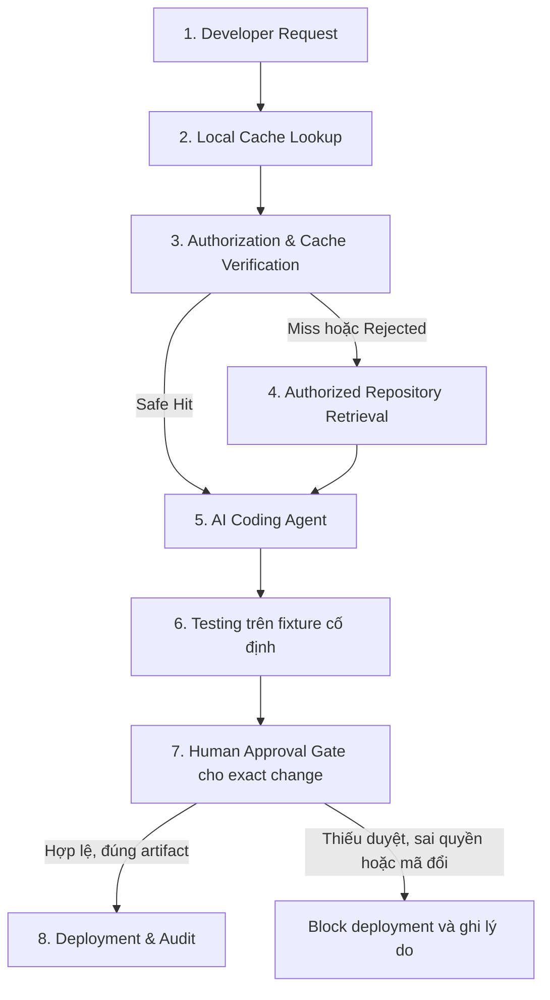

# Kiến trúc hệ thống

## Phạm vi và trạng thái

Kiến trúc nghiên cứu là Secure Local Semantic Cache; bối cảnh mục tiêu là AI-assisted software development trong [kịch bản báo giá duy nhất](../general/overview.md). Các phần Target dưới đây là **thiết kế, chưa triển khai**. Không dùng tài liệu này làm bằng chứng Agent/cache/gate đã hoạt động.

## As-Is Architecture — khảo sát 2026-11-02

| Phần hiện có | Bằng chứng trong repo | Hành vi/giới hạn |
| --- | --- | --- |
| Next.js App Router | [layout](../../frontend/src/app/layout.tsx), [app shell](../../frontend/src/components/layout/app-shell.tsx) | Bốn khu Thiết lập/Chat/Số liệu/Tài liệu; providers giữ bộ nhớ phiên, chưa nối API nghiệp vụ |
| Chat | [use-chat](../../frontend/src/features/chat/use-chat.ts), [demo-reply](../../frontend/src/features/chat/demo-reply.ts) | Hai nhánh gọi mô phỏng có delay; không LLM, không lookup, không telemetry thật |
| Số liệu | [metrics-preview](../../frontend/src/features/metrics/metrics-preview.ts), [metrics-model](../../frontend/src/features/metrics/metrics-model.ts) | Fixture UI 24 query hoặc dữ liệu phiên; không kết quả benchmark |
| Thiết lập | [setup-workspace](../../frontend/src/features/setup/setup-workspace.tsx), [workspace-model](../../frontend/src/features/workspace/workspace-model.ts) | Validation/snapshot/JSON results null; không runner hoặc cấp quyền |
| Tài liệu | [document-model](../../frontend/src/features/documents/document-model.ts), [provider](../../frontend/src/features/documents/documents-provider.tsx) | Giữ File/metadata trong phiên; không đọc/upload/index |
| FastAPI | [main.py](../../backend/app/main.py), [test health](../../backend/tests/test_health.py) | Chỉ GET /health xác nhận process liveness và CORS local; không auth/DB/model |
| PostgreSQL/pgvector | [compose](../../infra/compose.yaml), [init SQL](../../infra/init.sql) | Cấu hình hạ tầng, chưa schema/adapter/migration hoặc kiểm chứng DB trong lượt khảo sát |
| Research | `research/datasets/`, `research/results/` | Chỗ dành sẵn; không có fixture báo giá, protocol chạy hoặc ghi chú bài báo được tìm thấy |

Trong code hiện tại không có IndexedDB/Dexie, matching/verification, Agent adapter, patch executor hoặc approval/deployment gate. Sau khảo sát tài liệu, đã thêm `/workspace` xem trước với diff/test/approval/nhật ký UI mô phỏng trong `frontend/src/features/developer/`; chưa đọc repo, chạy test nghiệp vụ, xác thực reviewer, tạo artifact hoặc audit log backend. Xem [frontend](../frontend/design.md) cho hành vi bản mẫu và [project status](../general/project-status.md) cho mốc kiểm chứng. Bảng khảo sát ban đầu bên trên ghi bốn màn cũ; điều hướng hiện tại thêm Workspace đứng đầu.

## Target Architecture — ba ranh giới chính, một repository

| Thành phần | Trách nhiệm mục tiêu |
| --- | --- |
| Supplier Quotation Management | App nghiệp vụ tối giản, hàng đợi báo giá giả lập, source thật; baseline chưa có rule mới. Fixture/test chỉ thuộc một nhiệm vụ, không dựng ERP |
| CacheSec Developer Workspace | Request, context có provenance, diff, test, review, approval và trace; tái sử dụng frontend hiện có |
| Local Semantic Cache | Repository Context Cache trong trình duyệt/web Workspace trước theo lựa chọn người dùng 2026-11-07; Answer Cache mở rộng. Storage/matching/validation tách trách nhiệm; không lưu approval để tự cấp phép |
| Trusted backend | Identity/tenant/repo và quyền hiện tại, registry provenance/integrity, cache verification, admission và invalidation |
| Authorized Repository Retrieval/RAG | Chỉ đọc snapshot/file được phép; index/chunk/vector gắn revision/hash. Upload tài liệu nội bộ cũ không phải bước bắt buộc của PoC mới |
| LLM/embedding/Agent adapters | API trước, local sau; LLM và embedding độc lập. Agent dùng context đã xác minh tạo patch qua công cụ có scope |
| Test executor | Chạy code/test thật trên một fixture đóng băng, lưu kết quả gắn patch/source/artifact; không nhận lệnh bất kỳ từ UI |
| Human Approval & Deployment Control | Một implementation chung cho hai workflow; duyệt exact change, kiểm tra đúng artifact và quyền tại deployment |
| Trace & Evaluation | Sự kiện liên kết xuyên workflow, năm chiều đo chính và chỉ số cache riêng; runner không phụ thuộc UI demo |

Giữ Next.js → FastAPI qua HTTP; PostgreSQL dự kiến cho metadata/control và pgvector khi retrieval/index cần. Người dùng đã chọn browser Context Cache cho web Workspace trước; TypeScript/IndexedDB/Dexie là hướng dự kiến, engine/schema cụ thể chưa chốt. Browser chỉ tìm/lưu candidate, backend xác minh nội dung/provenance/quyền/nguồn hiện tại trước khi Agent dùng context; không tin metadata/Hit do client tự khai. LLM vẫn xử lý request sau Context Hit. Vị trí storage cho adapter IDE về sau cần xác nhận riêng; server cache vẫn là đối chiếu mở rộng chưa chốt storage. Không yêu cầu mỗi trách nhiệm là microservice/class riêng hoặc sao chép cache/vector lên server chỉ vì đã có PostgreSQL/pgvector.

### Quy tắc độc lập giữa ứng dụng, Agent/IDE và cache

Đã thống nhất theo yêu cầu người dùng ngày 2026-11-07; đây là **quy tắc thiết kế, chưa được triển khai**. Tách cả source ứng dụng mục tiêu, không chỉ dữ liệu hoặc màn hình. Giữ một repository cho PoC, với ba ranh giới:

| Ranh giới | Sở hữu | Hướng phụ thuộc |
| --- | --- | --- |
| Ứng dụng báo giá | Source nghiệp vụ, API/giao diện báo giá và test của ứng dụng | Chạy được độc lập; không import lõi cache hoặc code điều phối Agent/IDE để thực hiện validation |
| Agent/IDE và control | UI code/chat, điều phối model/tools, repository adapter, proposal, test executor, approval/deployment và trace | Coi source báo giá là repository mục tiêu được cấp scope; tích hợp cache qua contract/adapter, không import nghiệp vụ để sửa hay chạy trực tiếp trong process control |
| Lõi cache | Storage/matching/validation, metadata/provenance và lifecycle tái sử dụng | Không import model/schema nghiệp vụ báo giá hoặc phụ thuộc một Agent/IDE cụ thể; dùng adapter storage/embedding và contract xác minh nguồn/quyền |

Agent/IDE có thể được thay bằng host tích hợp khác; ứng dụng báo giá có thể được thay bằng repo mục tiêu khác mà không sửa thuật toán lõi cache chỉ để đổi nghiệp vụ. Khả năng tái sử dụng này là yêu cầu kiến trúc, chưa phải bằng chứng đã tương thích với IDE/Agent bên ngoài. Adapter theo host chịu trách nhiệm ánh xạ context, identity/tenant/repo/scope, mọi nguồn phụ thuộc và phiên bản cấu hình. Contract xác minh phải dựa trên backend/provider đáng tin cậy; cache không nhận metadata tự khai làm quyền, không xác minh được thì không trả payload. Chi tiết API/packaging còn mở; vị trí local đã chọn browser cho PoC đầu, chưa chọn cho adapter ngoài. Không dựng plugin framework hoặc service riêng chỉ để tạo ranh giới.

Runtime báo giá và việc chạy bản sửa/test phải tách khỏi process control. Agent chỉ sửa source ứng dụng trong scope đã cấp; không được sửa code cache, gate hoặc policy của control để hoàn thành nhiệm vụ. Bản đề xuất được lưu riêng, diff UI phản ánh đúng bản đó; chỉ artifact đúng phiên bản/hash đã qua approval gate mới được kích hoạt cho runtime báo giá. Hiển thị hoặc sửa văn bản trên web không tự thay code đang chạy. Cơ chế sandbox, quyền executor và deploy target vẫn cần chốt theo [ranh giới tin cậy](authorization.md).

Dữ liệu báo giá, cache entries/vector và proposal/test/approval thuộc các chủ sở hữu riêng. Có thể tổ chức bảng/schema riêng trên cùng hạ tầng khi phù hợp; không bắt buộc database hay Git repository riêng cho mỗi thành phần hoặc mỗi revision. Không đọc chéo bảng nội bộ để bỏ qua contract. Server cache storage chưa chốt; cache không lưu approval để cấp quyền. Các lượt thực nghiệm vẫn dùng cùng fixture cố định và quy trình reset đã khóa.

### Tích hợp CacheSec vào IDE và Agent

Theo yêu cầu người dùng ngày 2026-11-07, mục tiêu là Developer có thể dùng cache trong IDE/Agent được hỗ trợ, không phải chuyển sang web Workspace hoặc chạy kèm ứng dụng báo giá. Web Workspace là một host sử dụng cùng contract; VS Code là ví dụ host mở rộng, chưa có extension/SDK hoặc adapter bên ngoài hoạt động.

Contract chung phải có phiên bản và được tài liệu hóa để Developer viết tích hợp; bao phủ lookup, admission/lưu, xác minh và invalidation theo [thiết kế cache](cache.md). Có thể cung cấp qua SDK nhúng trong host hoặc API qua adapter khi cần; chưa chốt hình thức đóng gói, transport hay dịch vụ triển khai. Browser local là lựa chọn cho web PoC, không buộc mọi adapter ngoài dùng browser session, UI web, API nội bộ của một IDE hoặc một model provider.

Adapter IDE/Agent nối vào bước lấy ngữ cảnh hoặc câu trả lời của Agent, chuyển đổi request/provenance và cấu hình theo contract; authority và nguồn hiện tại vẫn phải được backend/provider tin cậy xác minh. Bật/tắt cache chỉ thay đường reuse, không bỏ authorization, test hoặc approval gate. Cài extension riêng không tự khiến mọi Agent/extension khác gọi cache; phải có điểm tích hợp với Agent tương ứng. Chỉ công bố hỗ trợ tổ hợp host/Agent/adapter đã kiểm chứng, gồm đường Hit/Miss/Rejected, lỗi xác minh và nguồn/quyền thay đổi; không suy ra tương thích mọi IDE từ contract chung.

Trải nghiệm mục tiêu là cài adapter phù hợp, cấu hình/xác thực, chọn workspace/repo được phép rồi làm việc với Agent như thường; trạng thái cache ngắn và chi tiết mở khi cần. PoC vẫn ưu tiên một đường tích hợp trong kịch bản đã khóa; hỗ trợ nhiều IDE là hướng mở rộng, không thêm workload/fixture hoặc biến việc phát triển extension thành thay đổi phần mềm thứ hai trong thí nghiệm. Hiện chỉ chốt quy tắc thiết kế này; contract cụ thể và adapter đầu tiên còn cần chọn trước triển khai.

## Luồng mục tiêu tám bước

1. **Developer Request:** xác định identity/tenant/repo, snapshot gốc, request/task ID và đúng yêu cầu ngày hết hạn. Phân biệt câu hỏi tìm hiểu repo với yêu cầu thực thi thay đổi.
2. **Local Lookup:** chỉ tìm candidate trong namespace/scopes được phép; embedding nếu cần. Chưa tìm được candidate là Miss, chưa được xem là Hit.
3. **Authorization & Verification:** backend đối chiếu metadata tin cậy và nội dung, quyền hiện tại, ngữ nghĩa/intent, phạm vi context, mọi nguồn/hash/version, freshness/TTL/policy/config. Safe Hit chỉ khi tất cả đạt; client không tự khai ALLOW. [Cache flow](cache.md) sở hữu chi tiết.
4. **Authorized Retrieval:** Miss/Rejected đi vào retrieval có phân quyền; source không được phép hoặc verifier không khả dụng không dẫn tới truy xuất rộng hơn. Ghi provenance của context mới; có thể gọi LLM trả lời câu hỏi và admission nếu đủ điều kiện.
5. **AI Agent:** dùng context đúng snapshot tìm vị trí và tạo patch cho một rule. Với Context Cache đã chọn, Hit cung cấp ngữ cảnh xác minh để LLM tiếp tục xử lý, không tự tránh lần gọi model hoặc chứng minh tiết kiệm token. Answer Cache về sau có thể tránh sinh lại answer tra cứu nhưng không tự hoàn thành patch. Không tự chạy cached patch/approval. Trước sửa, đối chiếu source thực tế với snapshot; mã đổi thì đọc/xác minh lại.
6. **Testing:** kiểm thử validation, hồi quy và gate trên fixture đã khóa. Lưu stdout/stderr đã lọc, pass/fail/error/timeout, source/patch/artifact/test/fixture/config hashes. Test pass không phải approval. Test fail đưa về sửa đúng nhiệm vụ và chạy lại, không tự deploy.
7. **Human Approval:** người có thẩm quyền xem diff chính xác và kết quả test; backend ghi quyết định tường minh gắn exact change. Từ chối/thiếu duyệt/sai quyền/đổi patch hoặc artifact chặn deployment; mã đổi cần test và approval mới. Self-approval và thời hạn duyệt còn mở.
8. **Deployment & Audit:** control kiểm tra lại quyền, approval còn hiệu lực và binding của đúng artifact; chỉ kích hoạt artifact bất biến đã duyệt, ghi deployed/blocked/failed. Không rebuild một artifact khác sau approval rồi coi là đã duyệt. Đây là control PoC dự kiến, chưa có deploy thật.

Với câu hỏi tra cứu thuần túy, Safe Hit có thể kết thúc bằng answer thay vì đi tiếp tạo patch. Sơ đồ mô tả workflow thay đổi code; không buộc mỗi query tìm hiểu repo đều phải deploy.

## Authorization, approval và ranh giới tin cậy

Browser và nội dung repository/LLM không có thẩm quyền cấp quyền hoặc duyệt. Backend giữ identity/policy/provenance đáng tin cậy. Cache verification kiểm soát **reuse thông tin**; gate kiểm soát **triển khai thay đổi**. Vai trò, giả mạo cache, source/policy stale, prompt injection từ repo, thu hồi quyền reviewer và TOCTOU thuộc [authorization](authorization.md).

Đề xuất định danh exact change bằng tuple bất biến gồm repo ID, base/source revision, patch digest, artifact digest, fixture/test/config digests. Approval và deployment event cùng tham chiếu tuple; schema và cơ chế hash/chứng thực chưa chốt. Hash client gửi không tự chứng minh artifact đáng tin hoặc đúng quyền.

## Dữ liệu/API và tổ chức dự kiến

Backend hiện có **GET /health** cho process liveness và **GET /ready** cho PostgreSQL probe; response và giới hạn tại [API nền](api.md#endpoint-nền-đã-triển-khai). [Database adapter](../../backend/app/database.py) không phụ thuộc HTTP, workflow hoặc app báo giá; mở connection theo thao tác, commit/rollback/close qua context manager của Psycopg. Không retry transaction hoặc tạo schema/extension tự động. Phần lưu trữ báo giá đã triển khai được mô tả ngay dưới; LLM, cache, authority và API workflow vẫn chưa được triển khai.

### Lưu trữ báo giá đã triển khai

Lát cắt ngày 2026-11-07 có [domain models](../../backend/app/quotation_demo/models.py), [PostgreSQL store](../../backend/app/quotation_demo/storage.py) và [migration CLI](../../backend/app/quotation_demo/migrate.py), chưa có API/runtime validation hoặc UI báo giá thật. Package app không import app.main/app.config, HTTP, Agent hoặc cache; chỉ dùng adapter kết nối trung lập. QUOTATION_DATABASE_URL là cấu hình riêng, không tự fallback sang DATABASE_URL của control. Local hiện dùng chung PostgreSQL nhưng tách schema; đây là ranh giới sở hữu, chưa phải phân quyền database đã thực thi.

Schema quotation_demo có bảng quotations với **đúng sáu cột**:

| Cột | PostgreSQL | Ràng buộc/lưu giữ |
| --- | --- | --- |
| id | uuid PRIMARY KEY | App sinh UUID4 khi tạo; input tạo không được mang id |
| supplier_name | text NOT NULL | Giữ nguyên chuỗi, chưa áp danh mục hoặc giới hạn nghiệp vụ |
| description | text NOT NULL | Giữ nguyên chuỗi; SQL dùng parameters |
| total_amount | text NOT NULL + decimal syntax CHECK | Giữ lexeme thập phân, dấu/zero đầu/cuối và precision, không dùng float hoặc tự làm tròn |
| currency | text NOT NULL | Chưa áp danh sách currency, quy đổi hoặc precision theo currency |
| expires_on | json, nullable | SQL NULL = thiếu field; JSON null = null tường minh; không date parsing hoặc CHECK ngày |

DecimalString nhận dạng `[+-]?[0-9]+(\.[0-9]+)?` trên toàn chuỗi; không nhận exponent/whitespace/NaN/Infinity hoặc ép JSON number thành string. Đây là kiểm tra biểu diễn, chưa thêm quy tắc tiền dương/min/max hoặc currency. expires_on nhận giá trị JSON hữu hạn, kể cả chuỗi ngày sai/rỗng, boolean, số, array/object. Dùng JSON thay vì JSONB vì không cần truy vấn/index ngày và cần giữ đầu vào; không chuyển ngày sai thành null. Model dùng model_fields_set để nhớ missing; khi xuất wire phải dùng exclude_unset=True để không biến missing thành null. Các giới hạn JSON/encoding của storage vẫn áp dụng; không coi lỗi lưu trữ là ngày đã được validate.

PostgresQuotationStore nhận connection do caller quản lý transaction; create/get/list không tự commit hoặc cấp quyền. get không tìm thấy trả None; list dùng keyset UUID tăng dần, mặc định 50 mục, đọc limit+1 để tạo next_cursor. Thứ tự là UUID, không phải ngày tạo; từng trang đọc snapshot tại statement hiện tại, chưa bảo đảm snapshot nhất quán qua nhiều request. Cursor không phải quyền; policy/giới hạn HTTP và scope vẫn phải thiết kế tại T04 trước công khai API. Không tạo service wrapper rỗng khi chưa có logic nghiệp vụ cần tách thêm.

Metadata migration nằm riêng ở quotation_demo.schema_migrations (name PK, checksum, applied_at timestamptz). Runner lấy transaction advisory lock cho app, xác minh version/checksum đã áp dụng rồi chạy batch trong transaction. Checksum SHA-256 của SQL UTF-8 chuẩn hóa CRLF thành LF để không lệch giữa Windows/Linux; đây là phát hiện sửa migration, không phải cơ chế chứng thực artifact/approval. Chạy lại là no-op và giữ dữ liệu; migration lạ/checksum đổi bị từ chối, SQL lỗi rollback cả schema/history mới trong batch. Nếu gọi trong transaction có sẵn, caller vẫn quyết định commit cuối; CLI chỉ báo ok sau khi commit thành công. Migration table có version nhưng không tự chứng minh mọi DDL trong DB chưa bị sửa ngoài runner.

Đã áp dụng 001_create_quotations.sql vào DB local, chưa seed/reset dữ liệu nghiên cứu. Sửa schema tiếp theo bằng migration forward mới; không chỉnh SQL đã ghi checksum. Khi lỗi batch có thể sửa bản chưa áp dụng và chạy lại sau rollback; khôi phục dữ liệu đã commit cần quy trình backup/restore được thiết kế riêng. Test tạo DB ngẫu nhiên riêng và chỉ dọn chính DB đã tạo, không reset app database. Lệnh chạy và yêu cầu CREATEDB của test ở [setup](../general/setup.md#2a-migration-và-storage-báo-giá).

Phần dữ liệu app này là đầu ra T03/T05 được triển khai theo yêu cầu; ERD/control/artifact lifecycle, identity/scope và gate của toàn hệ thống vẫn chờ T03–T04. Không có rule expiration_review, artifact mới được kích hoạt hoặc fixture nghiên cứu được đóng băng trong lát cắt này.

### Bản nháp T02: module và contract

Soạn ngày 2026-11-07 từ đầu vào kỹ thuật T01 đã được người dùng chọn; **chưa khóa contract hoặc triển khai endpoint**. Bộ sáu trường báo giá, rule ngày, Context Cache/browser, identity fixture và self-approval có quyền Reviewer theo [overview](../general/overview.md#hồ-sơ-đầu-vào-t01--đang-thực-hiện). Acceptance nghiên cứu chờ cô quy định; không đưa giá trị mặc định 100% vào API hoặc dùng nó để quyết định một run đã đạt nghiệm thu.

#### Module và hướng gọi

| Module/trách nhiệm dự kiến | Sở hữu dữ liệu/hành vi | Giao tiếp |
| --- | --- | --- |
| Ứng dụng báo giá độc lập | Sáu trường nghiệp vụ, validation nền, API báo giá và runtime artifact đang hoạt động | Web báo giá gọi API app; control quản lý activation qua launcher/adapter, không import nghiệp vụ vào process control |
| Identity và scope | Principal fixture backend quản lý, capability theo tenant/repo/action | Các thao tác control/retrieval/verification/gate phải kiểm tra quyền hiện tại; UI không tự cấp role |
| Repository/context | Repo allowlist, snapshot/file hashes, retrieval được phép và dependency manifest | Workflow gọi adapter đọc nguồn trong scope; không cung cấp API đọc path bất kỳ trên máy |
| Workflow/proposal | Request/run, source/diff/revision, test/artifact references, trạng thái và event links | Điều phối generation, executor, quyết định người dùng và gate; không trộn object báo giá vào lõi cache |
| Browser cache và trusted verifier | Candidate/payload local; bằng chứng provenance/integrity và quyền/nguồn do backend xác minh | Browser tìm/lưu candidate qua contract chung; verifier cung cấp context hợp lệ cho workflow, không tin browser báo Hit |
| Generation và embedding adapters | Request/response model, usage/error/duration và cấu hình có phiên bản | Workflow dùng generation; matching dùng embedding khi cần, không gắn cố định provider vào storage |
| Executor và deployment control | Bản làm việc riêng, test evidence, artifact bất biến, approval binding và activation | Chạy ngoài process control theo sandbox/allowlist chốt tại T04; mọi activation rule mới đi qua cùng gate |

Đây là ranh giới trách nhiệm, không phải yêu cầu tạo một microservice/class cho mỗi hàng. Tên thư mục/entrypoint cụ thể và các kiểu dữ liệu sẽ hoàn thiện trong T02–T03 trước khi tạo source mới.

Phân bổ source cho giai đoạn triển khai theo thiết kế T02, chưa tạo các đường dẫn mới:

| Vị trí | Vai trò và ranh giới |
| --- | --- |
| backend/app/main.py, config.py và database.py hiện có | Entrypoint/config control, health/readiness và adapter PostgreSQL; chưa có endpoint workflow. database.py không import config/control để adapter có thể tái sử dụng độc lập |
| backend/app/quotation_demo/ | Đã có models/storage/config và migration CLI chạy độc lập; main.py/API app chưa tạo. App không import app.main, app.config, workflow hoặc cache; app/__init__.py không khởi tạo control khi import app báo giá |
| backend/app/identity/, repositories/, workflows/, cache_verification/, integrations/, execution/ | Nhóm trách nhiệm control/adapter; chỉ tạo module khi thực hiện năng lực tương ứng, không scaffold thư mục/tầng rỗng. execution gọi worker/launcher theo contract, cơ chế sandbox/worker entrypoint chờ T04 |
| frontend/src/lib/cache/ | Logic local cache/contract TypeScript tách UI; không import React/Next hoặc object báo giá. Storage và HTTP verifier là adapter riêng; engine chưa chọn |
| backend/tests/ và research/datasets/ | Test theo namespace app/control/cache và fixture đọc theo schema chung; backend/app không import script nghiên cứu. Không tạo fixture thực nghiệm thứ hai |

T02 chọn ranh giới và vị trí module theo cấu trúc hiện có, không đổi tên repository hoặc dịch chuyển source đã có. Lệnh chạy app/control sẽ ghi vào setup khi entrypoint thật được triển khai; chưa có lệnh mới nào được kiểm chứng.

#### Đặc tả thao tác và dữ liệu

Chi tiết request/response, ContextRequest/WorkflowRun/AgentTurn, proposal/test/binding/decision/deployment, HTTP routes, capability matrix, state transitions, retry và lỗi được quản lý tại [contract backend và cache v0.2](api.md). Tách tài liệu để kiến trúc giữ ranh giới module/runtime, API có một nơi sở hữu, không chép lặp hai bảng route khác nhau.

Bản v0.2 đề xuất chuẩn bị ContextRequest trước local lookup để backend xác định repo/snapshot/namespace/config, sau đó mới nhận candidate report và xác minh trước khi LLM dùng. expires_on giữ missing/null/raw ở HTTP/storage để rule mới được kiểm tra thật. Các GET/status/events/context đều cần quyền hiện tại; self-approval cần human Reviewer, không ủy quyền cho Agent.

Đầu ra thiết kế T02 v0.2 đã soạn và được rà theo phạm vi kỹ thuật, dùng để chuyển sang T03; việc đối chiếu T03–T04 và khóa policy còn phía trước. Mapping grants/freshness, algorithms/integrity, storage/schema, sandbox/activation, cancellation/deadlines và resource limits vẫn mở; ngưỡng nghiên cứu tiếp tục chờ cô. Không tạo OpenAPI/Pydantic/SQL hoặc endpoint ở bước này.

Module nghiệp vụ đặt riêng trong `backend/app/`; adapter LLM, embedding và Agent tách khỏi HTTP/storage. `frontend/src/lib/` dự kiến chứa API client/cache khi cần; chưa có implementation hiện tại. App báo giá có thể ở `backend/app/quotation_demo/`, test trong `backend/tests/`, fixture ở `research/datasets/`; cấu trúc cụ thể là đề xuất trong [implementation plan](../general/implementation-plan.md). Vị trí thư mục không cho phép trộn nghiệp vụ với control/cache: khi triển khai phải có entrypoint chạy app độc lập và tuân thủ ba ranh giới bên trên. Backend không phụ thuộc script nghiên cứu; fixture đọc theo contract chung.

Cần chốt tool executor/sandbox và đường deploy PoC trước cấp quyền Agent. Mọi read/write/test nằm trong repo/scope đã cấp; source repo là dữ liệu, chỉ dẫn trong source không được đổi policy/control. Ưu tiên module nhỏ, không tự thêm SDK/dịch vụ/framework.
