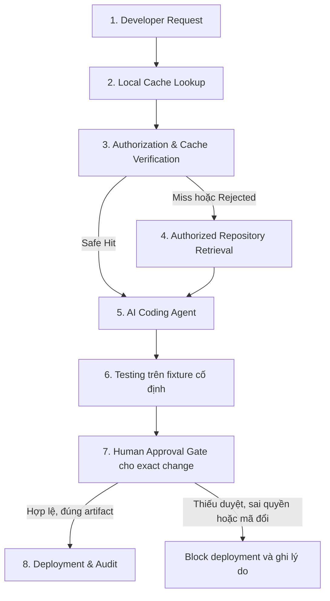

# Kiến trúc hệ thống

## Phạm vi và trạng thái

Kiến trúc nghiên cứu là Secure Local Semantic Cache; bối cảnh mục tiêu là AI-assisted software development trong [kịch bản báo giá duy nhất](../general/overview.md). Các phần Target dưới đây là **thiết kế, chưa triển khai**. Không dùng tài liệu này làm bằng chứng Agent/cache/gate đã hoạt động.

## As-Is Architecture — khảo sát 2026-11-02

| Phần hiện có | Bằng chứng trong repo | Hành vi/giới hạn |
| --- | --- | --- |
| Next.js App Router | [layout](../../frontend/src/app/layout.tsx), [app shell](../../frontend/src/components/layout/app-shell.tsx) | Bốn khu Thiết lập/Chat/Số liệu/Tài liệu; providers giữ bộ nhớ phiên, chưa nối API nghiệp vụ |
| Chat | [use-chat](../../frontend/src/features/chat/use-chat.ts), [demo-reply](../../frontend/src/features/chat/demo-reply.ts) | Hai nhánh gọi mô phỏng có delay; không LLM, không lookup, không telemetry thật |
| Số liệu | [metrics-preview](../../frontend/src/features/metrics/metrics-preview.ts), [metrics-model](../../frontend/src/features/metrics/metrics-model.ts) | Fixture UI 24 query hoặc dữ liệu phiên; không kết quả benchmark |
| Thiết lập | [setup-workspace](../../frontend/src/features/setup/setup-workspace.tsx), [workspace-model](../../frontend/src/features/workspace/workspace-model.ts) | Validation/snapshot/JSON results null; không runner hoặc cấp quyền |
| Tài liệu | [document-model](../../frontend/src/features/documents/document-model.ts), [provider](../../frontend/src/features/documents/documents-provider.tsx) | Giữ File/metadata trong phiên; không đọc/upload/index |
| FastAPI | [main.py](../../backend/app/main.py), [test health](../../backend/tests/test_health.py) | Chỉ GET /health xác nhận process liveness và CORS local; không auth/DB/model |
| PostgreSQL/pgvector | [compose](../../infra/compose.yaml), [init SQL](../../infra/init.sql) | Cấu hình hạ tầng, chưa schema/adapter/migration hoặc kiểm chứng DB trong lượt khảo sát |
| Research | `research/datasets/`, `research/results/` | Chỗ dành sẵn; không có fixture báo giá, protocol chạy hoặc ghi chú bài báo được tìm thấy |

Trong code hiện tại không có IndexedDB/Dexie, matching/verification, Agent adapter, patch executor hoặc approval/deployment gate. Sau khảo sát tài liệu, đã thêm `/workspace` xem trước với diff/test/approval/nhật ký UI mô phỏng trong `frontend/src/features/developer/`; chưa đọc repo, chạy test nghiệp vụ, xác thực reviewer, tạo artifact hoặc audit log backend. Xem [frontend](../frontend/design.md) cho hành vi bản mẫu và [project status](../general/project-status.md) cho mốc kiểm chứng. Bảng khảo sát ban đầu bên trên ghi bốn màn cũ; điều hướng hiện tại thêm Workspace đứng đầu.

## Target Architecture — hai thành phần logic, một repository

| Thành phần | Trách nhiệm mục tiêu |
| --- | --- |
| Supplier Quotation Management | App nghiệp vụ tối giản, hàng đợi báo giá giả lập, source thật; baseline chưa có rule mới. Fixture/test chỉ thuộc một nhiệm vụ, không dựng ERP |
| CacheSec Developer Workspace | Request, context có provenance, diff, test, review, approval và trace; tái sử dụng frontend hiện có |
| Local Semantic Cache | Answer Cache cục bộ trước; Context Cache mở rộng. Storage/matching/validation tách trách nhiệm; không lưu approval để tự cấp phép |
| Trusted backend | Identity/tenant/repo và quyền hiện tại, registry provenance/integrity, cache verification, admission và invalidation |
| Authorized Repository Retrieval/RAG | Chỉ đọc snapshot/file được phép; index/chunk/vector gắn revision/hash. Upload tài liệu nội bộ cũ không phải bước bắt buộc của PoC mới |
| LLM/embedding/Agent adapters | API trước, local sau; LLM và embedding độc lập. Agent dùng context đã xác minh tạo patch qua công cụ có scope |
| Test executor | Chạy code/test thật trên một fixture đóng băng, lưu kết quả gắn patch/source/artifact; không nhận lệnh bất kỳ từ UI |
| Human Approval & Deployment Control | Một implementation chung cho hai workflow; duyệt exact change, kiểm tra đúng artifact và quyền tại deployment |
| Trace & Evaluation | Sự kiện liên kết xuyên workflow, năm chiều đo chính và chỉ số cache riêng; runner không phụ thuộc UI demo |

Giữ Next.js → FastAPI qua HTTP; PostgreSQL/pgvector dự kiến lưu metadata/vector được phép; TypeScript/IndexedDB/Dexie dự kiến lưu local browser cache. Vị trí local còn cần xác nhận khi chọn Agent integration; không tự chuyển sang agent-side disk cache hoặc thêm dịch vụ. Server cache vẫn là đối chiếu mở rộng, storage chưa chốt. Không yêu cầu mỗi trách nhiệm là microservice/class riêng.

## Luồng mục tiêu tám bước

1. **Developer Request:** xác định identity/tenant/repo, snapshot gốc, request/task ID và đúng yêu cầu ngày hết hạn. Phân biệt câu hỏi tìm hiểu repo với yêu cầu thực thi thay đổi.
2. **Local Lookup:** chỉ tìm candidate trong namespace/scopes được phép; embedding nếu cần. Chưa tìm được candidate là Miss, chưa được xem là Hit.
3. **Authorization & Verification:** backend đối chiếu metadata tin cậy và nội dung, quyền hiện tại, ngữ nghĩa/intent, phạm vi context, mọi nguồn/hash/version, freshness/TTL/policy/config. Safe Hit chỉ khi tất cả đạt; client không tự khai ALLOW. [Cache flow](cache.md) sở hữu chi tiết.
4. **Authorized Retrieval:** Miss/Rejected đi vào retrieval có phân quyền; source không được phép hoặc verifier không khả dụng không dẫn tới truy xuất rộng hơn. Ghi provenance của context mới; có thể gọi LLM trả lời câu hỏi và admission nếu đủ điều kiện.
5. **AI Agent:** dùng context đúng snapshot tìm vị trí và tạo patch cho một rule. Answer Cache có thể tránh sinh lại câu trả lời tra cứu; yêu cầu tạo patch vẫn cần Agent/LLM nếu không có cơ chế khác được kiểm chứng. Không tự chạy cached patch/approval. Trước sửa, đối chiếu source thực tế với snapshot; mã đổi thì đọc/xác minh lại.
6. **Testing:** kiểm thử validation, hồi quy và gate trên fixture đã khóa. Lưu stdout/stderr đã lọc, pass/fail/error/timeout, source/patch/artifact/test/fixture/config hashes. Test pass không phải approval. Test fail đưa về sửa đúng nhiệm vụ và chạy lại, không tự deploy.
7. **Human Approval:** người có thẩm quyền xem diff chính xác và kết quả test; backend ghi quyết định tường minh gắn exact change. Từ chối/thiếu duyệt/sai quyền/đổi patch hoặc artifact chặn deployment; mã đổi cần test và approval mới. Self-approval và thời hạn duyệt còn mở.
8. **Deployment & Audit:** control kiểm tra lại quyền, approval còn hiệu lực và binding của đúng artifact; chỉ kích hoạt artifact bất biến đã duyệt, ghi deployed/blocked/failed. Không rebuild một artifact khác sau approval rồi coi là đã duyệt. Đây là control PoC dự kiến, chưa có deploy thật.

Với câu hỏi tra cứu thuần túy, Safe Hit có thể kết thúc bằng answer thay vì đi tiếp tạo patch. Sơ đồ mô tả workflow thay đổi code; không buộc mỗi query tìm hiểu repo đều phải deploy.

## Authorization, approval và ranh giới tin cậy

Browser và nội dung repository/LLM không có thẩm quyền cấp quyền hoặc duyệt. Backend giữ identity/policy/provenance đáng tin cậy. Cache verification kiểm soát **reuse thông tin**; gate kiểm soát **triển khai thay đổi**. Vai trò, giả mạo cache, source/policy stale, prompt injection từ repo, thu hồi quyền reviewer và TOCTOU thuộc [authorization](authorization.md).

Đề xuất định danh exact change bằng tuple bất biến gồm repo ID, base/source revision, patch digest, artifact digest, fixture/test/config digests. Approval và deployment event cùng tham chiếu tuple; schema và cơ chế hash/chứng thực chưa chốt. Hash client gửi không tự chứng minh artifact đáng tin hoặc đúng quyền.

## Dữ liệu/API và tổ chức dự kiến

API ứng dụng hiện có là **GET /health → {"status":"ok"}**; FastAPI cung cấp OpenAPI UI. Chưa có hợp đồng API mới được chốt. Cần thiết kế request/run, repository snapshot/source provenance, cache entry/verification, change proposal, test execution, approval, artifact và deployment decision với ID/phiên bản/lỗi nhất quán. Không mô tả URL dự kiến như endpoint đang chạy.

Module nghiệp vụ đặt trong `backend/app/`; adapter LLM, embedding và Agent tách khỏi HTTP/storage. `frontend/src/lib/` dự kiến chứa API client/cache khi cần; chưa có implementation hiện tại. App báo giá có thể ở `backend/app/quotation_demo/`, test trong `backend/tests/`, fixture ở `research/datasets/`; cấu trúc cụ thể là đề xuất trong [implementation plan](../general/implementation-plan.md). Backend không phụ thuộc script nghiên cứu; fixture đọc theo contract chung.

Cần chốt tool executor/sandbox và đường deploy PoC trước cấp quyền Agent. Mọi read/write/test nằm trong repo/scope đã cấp; source repo là dữ liệu, chỉ dẫn trong source không được đổi policy/control. Ưu tiên module nhỏ, không tự thêm SDK/dịch vụ/framework.
