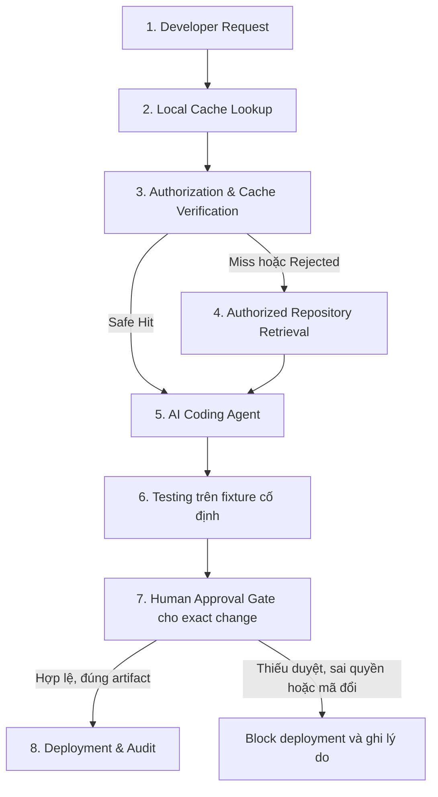
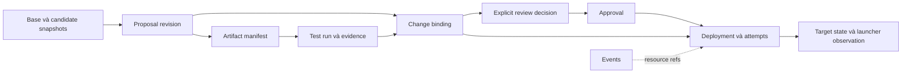

# Kiến trúc hệ thống

## Phạm vi và trạng thái

Kiến trúc nghiên cứu là Secure Local Semantic Cache; bối cảnh mục tiêu là AI-assisted software development trong [kịch bản báo giá duy nhất](../general/overview.md). Các phần Target dưới đây là **thiết kế, chưa triển khai**. Không dùng tài liệu này làm bằng chứng Agent/cache/gate đã hoạt động.

## As-Is Architecture — khảo sát 2026-11-02

| Phần hiện có | Bằng chứng trong repo | Hành vi/giới hạn |
| --- | --- | --- |
| Next.js App Router | [layout](../../frontend/src/app/layout.tsx), [app shell](../../frontend/src/components/layout/AppShell.tsx) | Bốn khu Thiết lập/Chat/Số liệu/Tài liệu; providers giữ bộ nhớ phiên, chưa nối API nghiệp vụ |
| Chat | [useChat](../../frontend/src/features/chat/useChat.ts), [demoReply](../../frontend/src/features/chat/demoReply.ts) | Hai nhánh gọi mô phỏng có delay; không LLM, không lookup, không telemetry thật |
| Số liệu | [metricsPreview](../../frontend/src/features/metrics/metricsPreview.ts), [metricsModel](../../frontend/src/features/metrics/metricsModel.ts) | Fixture UI 24 query hoặc dữ liệu phiên; không kết quả benchmark |
| Thiết lập | [SetupWorkspace](../../frontend/src/features/setup/SetupWorkspace.tsx), [experiment-config](../../frontend/src/features/experiment-config/) | Validation/snapshot/JSON results null; không runner hoặc cấp quyền |
| Tài liệu | [documentModel](../../frontend/src/features/documents/documentModel.ts), [provider](../../frontend/src/features/documents/DocumentsProvider.tsx) | Giữ File/metadata trong phiên; không đọc/upload/index |
| FastAPI | [control_api.py](../../backend/app/control/control_api.py), [test health](../../backend/tests/control/test_health.py) | Chỉ GET /health xác nhận process liveness và CORS local; không auth/DB/model |
| PostgreSQL/pgvector | [compose](../../infra/compose.yaml), [init SQL](../../infra/init.sql) | Cấu hình hạ tầng, chưa schema/adapter/migration hoặc kiểm chứng DB trong lượt khảo sát |
| Research | `research/datasets/`, `research/results/` | Chỗ dành sẵn; không có fixture báo giá, protocol chạy hoặc ghi chú bài báo được tìm thấy |

Trong code hiện tại không có IndexedDB/Dexie, matching/verification, Agent adapter, patch executor hoặc approval/deployment gate. Sau khảo sát tài liệu, đã thêm `/workspace` xem trước với diff/test/approval/nhật ký UI mô phỏng trong `frontend/src/features/developer/`; đã bổ sung đọc snapshot có quyền qua control HTTP ngày 2026-11-11; test nghiệp vụ, reviewer/gate, artifact và audit backend chưa có. Xem [frontend](../frontend/design.md) cho hành vi bản mẫu và [project status](../general/project-status.md) cho mốc kiểm chứng. Bảng khảo sát ban đầu bên trên ghi bốn màn cũ; điều hướng hiện tại thêm Workspace đứng đầu.

## Target Architecture — ba ranh giới chính, một repository

| Thành phần | Trách nhiệm mục tiêu |
| --- | --- |
| Supplier Quotation Management | App nghiệp vụ tối giản, hàng đợi báo giá giả lập, source thật; baseline chưa có rule mới. Fixture/test chỉ thuộc một nhiệm vụ, không dựng ERP |
| CacheSec Developer Workspace | Request, context có provenance, diff, test, review, approval và trace; tái sử dụng frontend hiện có |
| Local Semantic Cache | Repository Context Cache trong trình duyệt/web Workspace trước theo lựa chọn người dùng 2026-11-07; Answer Cache mở rộng. Storage/matching/validation tách trách nhiệm; không lưu approval để tự cấp phép |
| Trusted backend | Identity/tenant/repo và quyền hiện tại, registry provenance/integrity, cache verification, admission và invalidation |
| Authorized Repository Retrieval/RAG | Chỉ đọc snapshot/file được phép; index/chunk/vector gắn revision/hash. Upload tài liệu nội bộ cũ không phải bước bắt buộc của PoC mới |
| LLM/embedding/Agent adapters | API trước, local sau; LLM và embedding độc lập. Agent dùng context đã xác minh tạo patch qua công cụ có scope |
| Test executor | Chạy code/test thật trên một fixture đóng băng, lưu kết quả gắn patch/source/artifact; không nhận lệnh bất kỳ từ UI |
| Human Approval & Deployment Control | Một implementation chung cho hai workflow; duyệt exact change, kiểm tra đúng artifact và quyền tại deployment |
| Trace & Evaluation | Sự kiện liên kết xuyên workflow, năm chiều đo chính và chỉ số cache riêng; runner không phụ thuộc UI demo |

Giữ Next.js → FastAPI qua HTTP; PostgreSQL dự kiến cho metadata/control và pgvector khi retrieval/index cần. Người dùng đã chọn browser Context Cache cho web Workspace trước; TypeScript/IndexedDB/Dexie là hướng dự kiến, engine/schema cụ thể chưa chốt. Browser chỉ tìm/lưu candidate, backend xác minh nội dung/provenance/quyền/nguồn hiện tại trước khi Agent dùng context; không tin metadata/Hit do client tự khai. LLM vẫn xử lý request sau Context Hit. Vị trí storage cho adapter IDE về sau cần xác nhận riêng; server cache vẫn là đối chiếu mở rộng chưa chốt storage. Không yêu cầu mỗi trách nhiệm là microservice/class riêng hoặc sao chép cache/vector lên server chỉ vì đã có PostgreSQL/pgvector.

### Quy tắc độc lập giữa ứng dụng, Agent/IDE và cache

Đã thống nhất theo yêu cầu người dùng ngày 2026-11-07; đây là **quy tắc thiết kế, chưa được triển khai**. Tách cả source ứng dụng mục tiêu, không chỉ dữ liệu hoặc màn hình. Giữ một repository cho PoC, với ba ranh giới:

| Ranh giới | Sở hữu | Hướng phụ thuộc |
| --- | --- | --- |
| Ứng dụng báo giá | Source nghiệp vụ, API/giao diện báo giá và test của ứng dụng | Chạy được độc lập; không import lõi cache hoặc code điều phối Agent/IDE để thực hiện validation |
| Agent/IDE và control | UI code/chat, điều phối model/tools, repository adapter, proposal, test executor, approval/deployment và trace | Coi source báo giá là repository mục tiêu được cấp scope; tích hợp cache qua contract/adapter, không import nghiệp vụ để sửa hay chạy trực tiếp trong process control |
| Lõi cache | Storage/matching/validation, metadata/provenance và lifecycle tái sử dụng | Không import model/schema nghiệp vụ báo giá hoặc phụ thuộc một Agent/IDE cụ thể; dùng adapter storage/embedding và contract xác minh nguồn/quyền |

Agent/IDE có thể được thay bằng host tích hợp khác; ứng dụng báo giá có thể được thay bằng repo mục tiêu khác mà không sửa thuật toán lõi cache chỉ để đổi nghiệp vụ. Khả năng tái sử dụng này là yêu cầu kiến trúc, chưa phải bằng chứng đã tương thích với IDE/Agent bên ngoài. Adapter theo host chịu trách nhiệm ánh xạ context, identity/tenant/repo/scope, mọi nguồn phụ thuộc và phiên bản cấu hình. Contract xác minh phải dựa trên backend/provider đáng tin cậy; cache không nhận metadata tự khai làm quyền, không xác minh được thì không trả payload. Chi tiết API/packaging còn mở; vị trí local đã chọn browser cho PoC đầu, chưa chọn cho adapter ngoài. Không dựng plugin framework hoặc service riêng chỉ để tạo ranh giới.

Runtime báo giá và việc chạy bản sửa/test phải tách khỏi process control. Agent chỉ sửa source ứng dụng trong scope đã cấp; không được sửa code cache, gate hoặc policy của control để hoàn thành nhiệm vụ. Bản đề xuất được lưu riêng, diff UI phản ánh đúng bản đó; chỉ artifact đúng phiên bản/hash đã qua approval gate mới được kích hoạt cho runtime báo giá. Hiển thị hoặc sửa văn bản trên web không tự thay code đang chạy. Cơ chế sandbox, quyền executor và deploy target vẫn cần chốt theo [ranh giới tin cậy](authorization.md).

Dữ liệu báo giá, cache entries/vector và proposal/test/approval thuộc các chủ sở hữu riêng. Có thể tổ chức bảng/schema riêng trên cùng hạ tầng khi phù hợp; không bắt buộc database hay Git repository riêng cho mỗi thành phần hoặc mỗi revision. Không đọc chéo bảng nội bộ để bỏ qua contract. Server cache storage chưa chốt; cache không lưu approval để cấp quyền. Các lượt thực nghiệm vẫn dùng cùng fixture cố định và quy trình reset đã khóa.

### Tích hợp CacheSec vào IDE và Agent

Theo yêu cầu người dùng ngày 2026-11-07, mục tiêu là Developer có thể dùng cache trong IDE/Agent được hỗ trợ, không phải chuyển sang web Workspace hoặc chạy kèm ứng dụng báo giá. Web Workspace là một host sử dụng cùng contract; VS Code là ví dụ host mở rộng, chưa có extension/SDK hoặc adapter bên ngoài hoạt động.

Contract chung phải có phiên bản và được tài liệu hóa để Developer viết tích hợp; bao phủ lookup, admission/lưu, xác minh và invalidation theo [thiết kế cache](cache.md). Có thể cung cấp qua SDK nhúng trong host hoặc API qua adapter khi cần; chưa chốt hình thức đóng gói, transport hay dịch vụ triển khai. Browser local là lựa chọn cho web PoC, không buộc mọi adapter ngoài dùng browser session, UI web, API nội bộ của một IDE hoặc một model provider.

Adapter IDE/Agent nối vào bước lấy ngữ cảnh hoặc câu trả lời của Agent, chuyển đổi request/provenance và cấu hình theo contract; authority và nguồn hiện tại vẫn phải được backend/provider tin cậy xác minh. Bật/tắt cache chỉ thay đường reuse, không bỏ authorization, test hoặc approval gate. Cài extension riêng không tự khiến mọi Agent/extension khác gọi cache; phải có điểm tích hợp với Agent tương ứng. Chỉ công bố hỗ trợ tổ hợp host/Agent/adapter đã kiểm chứng, gồm đường Hit/Miss/Rejected, lỗi xác minh và nguồn/quyền thay đổi; không suy ra tương thích mọi IDE từ contract chung.

Trải nghiệm mục tiêu là cài adapter phù hợp, cấu hình/xác thực, chọn workspace/repo được phép rồi làm việc với Agent như thường; trạng thái cache ngắn và chi tiết mở khi cần. PoC vẫn ưu tiên một đường tích hợp trong kịch bản đã khóa; hỗ trợ nhiều IDE là hướng mở rộng, không thêm workload/fixture hoặc biến việc phát triển extension thành thay đổi phần mềm thứ hai trong thí nghiệm. Hiện chỉ chốt quy tắc thiết kế này; contract cụ thể và adapter đầu tiên còn cần chọn trước triển khai.

## Luồng mục tiêu tám bước

1. **Developer Request:** xác định identity/tenant/repo, snapshot gốc, request/task ID và đúng yêu cầu ngày hết hạn. Phân biệt câu hỏi tìm hiểu repo với yêu cầu thực thi thay đổi.
2. **Local Lookup:** chỉ tìm candidate trong namespace/scopes được phép; embedding nếu cần. Chưa tìm được candidate là Miss, chưa được xem là Hit.
3. **Authorization & Verification:** backend đối chiếu metadata tin cậy và nội dung, quyền hiện tại, ngữ nghĩa/intent, phạm vi context, mọi nguồn/hash/version, freshness/TTL/policy/config. Safe Hit chỉ khi tất cả đạt; client không tự khai ALLOW. [Cache flow](cache.md) sở hữu chi tiết.
4. **Authorized Retrieval:** Miss/Rejected đi vào retrieval có phân quyền; source không được phép hoặc verifier không khả dụng không dẫn tới truy xuất rộng hơn. Ghi provenance của context mới; có thể gọi LLM trả lời câu hỏi và admission nếu đủ điều kiện.
5. **AI Agent:** dùng context đúng snapshot tìm vị trí và tạo patch cho một rule. Với Context Cache đã chọn, Hit cung cấp ngữ cảnh xác minh để LLM tiếp tục xử lý, không tự tránh lần gọi model hoặc chứng minh tiết kiệm token. Answer Cache về sau có thể tránh sinh lại answer tra cứu nhưng không tự hoàn thành patch. Không tự chạy cached patch/approval. Trước sửa, đối chiếu source thực tế với snapshot; mã đổi thì đọc/xác minh lại.
6. **Testing:** kiểm thử validation, hồi quy và gate trên fixture đã khóa. Lưu stdout/stderr đã lọc, pass/fail/error/timeout, source/patch/artifact/test/fixture/config hashes. Test pass không phải approval. Test fail đưa về sửa đúng nhiệm vụ và chạy lại, không tự deploy.
7. **Human Approval:** người có thẩm quyền xem diff chính xác và kết quả test; backend ghi quyết định tường minh gắn exact change. Từ chối/thiếu duyệt/sai quyền/đổi patch hoặc artifact chặn deployment; mã đổi cần test và approval mới. Self-approval và thời hạn duyệt còn mở.
8. **Deployment & Audit:** control kiểm tra lại quyền, approval còn hiệu lực và binding của đúng artifact; chỉ kích hoạt artifact bất biến đã duyệt, ghi deployed/blocked/failed. Không rebuild một artifact khác sau approval rồi coi là đã duyệt. Đây là control PoC dự kiến, chưa có deploy thật.

Với câu hỏi tra cứu thuần túy, Safe Hit có thể kết thúc bằng answer thay vì đi tiếp tạo patch. Sơ đồ mô tả workflow thay đổi code; không buộc mỗi query tìm hiểu repo đều phải deploy.

## Authorization, approval và ranh giới tin cậy

Browser và nội dung repository/LLM không có thẩm quyền cấp quyền hoặc duyệt. Backend giữ identity/policy/provenance đáng tin cậy. Cache verification kiểm soát **reuse thông tin**; gate kiểm soát **triển khai thay đổi**. Vai trò, giả mạo cache, source/policy stale, prompt injection từ repo, thu hồi quyền reviewer và TOCTOU thuộc [authorization](authorization.md).

Đề xuất định danh exact change bằng tuple bất biến gồm repo ID, base/source revision, patch digest, artifact digest, fixture/test/config digests. Approval và deployment event cùng tham chiếu tuple; schema và cơ chế hash/chứng thực chưa chốt. Hash client gửi không tự chứng minh artifact đáng tin hoặc đúng quyền.

## Dữ liệu/API và tổ chức dự kiến

Control hiện có **GET /health** cho process liveness và **GET /ready** cho PostgreSQL probe; response và giới hạn tại [API nền](api.md#endpoint-nền-đã-triển-khai). [Database adapter](../../backend/app/shared/postgres_connection.py) không phụ thuộc HTTP, workflow hoặc app báo giá; mở connection theo thao tác, commit/rollback qua context manager và luôn đóng connection kể cả khi commit lỗi. Không retry transaction hoặc tạo schema/extension tự động. App báo giá có API/fixture authority riêng như dưới; HTTP repository/snapshot đã triển khai riêng bên dưới; LLM, cache và API workflow/gate chưa có.

### Lưu trữ báo giá đã triển khai

Lát cắt ngày 2026-11-07 có [models](../../backend/app/quotation_demo/business/quotation_models.py), [PostgreSQL repository](../../backend/app/quotation_demo/database/postgres_quotation_repository.py), [migration CLI](../../backend/app/quotation_demo/migrate_quotations.py) và [entrypoint API riêng](../../backend/app/quotation_demo/quotation_api.py). Ngày 2026-11-09 nối UI /quotations qua HTTP/CORS, sau đó đổi tên source theo các nhóm api/business/auth/database: tạo/danh sách/chi tiết và validate nền chạy thật với Bearer fixture; chưa có rule ngày hoặc runtime artifact. business không phụ thuộc HTTP/storage; factory ASGI bọc CORS ngoài app để response lỗi cũng đến được browser, không import control, Agent hoặc cache. QUOTATION_DATABASE_URL là cấu hình riêng, không tự fallback sang DATABASE_URL của control. Local dùng chung PostgreSQL nhưng tách schema; đây là ranh giới sở hữu, chưa phải phân quyền database đã thực thi.

Schema quotation_demo có bảng quotations với **đúng sáu cột**:

| Cột | PostgreSQL | Ràng buộc/lưu giữ |
| --- | --- | --- |
| id | uuid PRIMARY KEY | App sinh UUID4 khi tạo; input tạo không được mang id |
| supplier_name | text NOT NULL | Giữ nguyên chuỗi, chưa áp danh mục hoặc giới hạn nghiệp vụ |
| description | text NOT NULL | Giữ nguyên chuỗi; SQL dùng parameters |
| total_amount | text NOT NULL + decimal syntax CHECK | Giữ lexeme thập phân, dấu/zero đầu/cuối và precision, không dùng float hoặc tự làm tròn |
| currency | text NOT NULL | Chưa áp danh sách currency, quy đổi hoặc precision theo currency |
| expires_on | json, nullable | SQL NULL = thiếu field; JSON null = null tường minh; không date parsing hoặc CHECK ngày |

DecimalString nhận dạng `[+-]?[0-9]+(\.[0-9]+)?` trên toàn chuỗi; không nhận exponent/whitespace/NaN/Infinity hoặc ép JSON number thành string. Đây là kiểm tra biểu diễn, chưa thêm quy tắc tiền dương/min/max hoặc currency. expires_on nhận giá trị JSON hữu hạn, kể cả chuỗi ngày sai/rỗng, boolean, số, array/object. Dùng JSON thay vì JSONB vì không cần truy vấn/index ngày và cần giữ đầu vào; không chuyển ngày sai thành null. Model dùng model_fields_set để nhớ missing; khi xuất wire phải dùng exclude_unset=True để không biến missing thành null. Các giới hạn JSON/encoding của storage vẫn áp dụng; không coi lỗi lưu trữ là ngày đã được validate.

PostgresQuotationRepository nhận connection do caller quản lý transaction; create/get/list/create_once không tự commit hoặc cấp quyền. get không tìm thấy trả None; list dùng keyset UUID tăng dần, đọc limit+1 để tạo next_cursor. Thứ tự là UUID, không phải ngày tạo; từng trang đọc snapshot tại statement hiện tại, chưa bảo đảm snapshot nhất quán qua nhiều request. QuotationService kiểm quyền qua port trước mở PostgresQuotationTransactions; session commit trước khi HTTP có thể trả thành công, rollback khi lỗi và luôn đóng connection. [Bản đồ source/SOLID](code-organization.md#backend) ghi hướng phụ thuộc; [API](api.md#http-báo-giá-đã-triển-khai) sở hữu cap/phân trang/retry và [authorization](authorization.md#quyền-api-báo-giá-đã-triển-khai) sở hữu mapping/freshness.

Luồng validation nền: UI chi tiết → POST validate → service kiểm read/validate → đọc record trong transaction → [validator nghiệp vụ](../../backend/app/quotation_demo/business/quotation_validation.py). Function thuần sở hữu flags/result và là điểm sửa code cho bài toán sau này; không import API/storage/control/cache. Theo contract nền đã chọn, hiện chưa có business rule nên flags/evaluated_rules rỗng, không parse hoặc xác nhận ngày. reference_date/active_artifact null công bố rõ metadata chưa có, không dùng hash file/profile label thay artifact thật. Validation không sửa sáu cột, thêm bảng, lưu kết quả hoặc ghi approval; launcher/runtime config và gate còn phải thiết kế/triển khai trước đóng băng baseline nghiên cứu.

Migration 002 thêm bảng metadata quotation_demo.creation_requests, không thêm cột vào quotations: principal_id, scope_id, key_hash, payload_hash, quotation_id (FK) và created_at. PK là (principal_id, scope_id, key_hash). SHA-256 đối chiếu key/payload chuẩn hóa; transaction advisory lock theo principal/scope/key ngăn tạo trùng khi retry song song. Collision của lock chỉ làm serialize; quyết định reuse vẫn dựa PK/hash đầy đủ. Metadata và quotation cùng transaction; lỗi commit rollback cả hai. Principal/scope lấy từ authority, không từ client. Chưa có TTL/GC/reset tự động; metadata hiện giữ nguyên, chưa có audit durability/integrity bảo vệ trước người quản trị DB. Không dùng hash retry làm cơ chế approval/cache integrity.

Metadata migration nằm riêng ở quotation_demo.schema_migrations (name PK, checksum, applied_at timestamptz). Runner lấy transaction advisory lock cho app, xác minh version/checksum đã áp dụng rồi chạy batch trong transaction. Checksum SHA-256 của SQL UTF-8 chuẩn hóa CRLF thành LF để không lệch giữa Windows/Linux; đây là phát hiện sửa migration, không phải cơ chế chứng thực artifact/approval. Chạy lại là no-op và giữ dữ liệu; migration lạ/checksum đổi bị từ chối, SQL lỗi rollback cả schema/history mới trong batch. Nếu gọi trong transaction có sẵn, caller vẫn quyết định commit cuối; CLI chỉ báo ok sau khi commit thành công. Migration table có version nhưng không tự chứng minh mọi DDL trong DB chưa bị sửa ngoài runner.

Đã áp dụng 001_create_quotations.sql và 002_creation_requests.sql vào DB local, replay no-op; chưa seed/reset dữ liệu nghiên cứu. Sửa schema tiếp theo bằng migration forward mới; không chỉnh SQL đã ghi checksum. Khi lỗi batch có thể sửa bản chưa áp dụng và chạy lại sau rollback; khôi phục dữ liệu đã commit cần quy trình backup/restore được thiết kế riêng. Test tạo DB ngẫu nhiên riêng và chỉ dọn chính DB đã tạo, không reset app database. Lệnh chạy và yêu cầu CREATEDB của test ở [setup](../general/setup.md#2a-migration-và-storage-báo-giá).

Phần dữ liệu/API/quyền app này là lát cắt T03–T07 được triển khai theo yêu cầu; ERD/control/artifact lifecycle, identity/scope repo/control và gate toàn hệ thống vẫn chờ T03–T04. Không có rule expiration_review, artifact mới được kích hoạt hoặc fixture nghiên cứu được đóng băng trong lát cắt này.

### Nền blob control đã triển khai

Theo gói local v0.1 đã chọn, bước đầu triển khai **storage bytes và index nội bộ**; registry quyền được bổ sung riêng bên dưới. Migration control 001_artifact_blobs.sql tạo:

| Bảng/cột | Vai trò đã chạy |
| --- | --- |
| control.schema_migrations | History/checksum/transaction lock riêng, độc lập quotation_demo |
| control.artifact_blobs.digest | PK, sha256: + 64 chữ hex thường, CHECK chiều dài và biểu diễn |
| byte_size | bigint từ 0 đến 1.048.576 byte; không lưu payload trong SQL |
| created_at | Thời điểm index row được ghi, không phải thời điểm artifact được test/duyệt |

[ArtifactBlobStorage](../../backend/app/artifacts/blob_storage_service.py) nhận port nhỏ cho bytes và metadata transaction; [FileSystemBlobStore](../../backend/app/artifacts/filesystem_blob_store.py) và [PostgresBlobMetadataTransactions](../../backend/app/artifacts/postgres_blob_metadata.py) là adapter. Control factory lắp ghép từ DATABASE_URL và CONTROL_ARTIFACT_ROOT tường minh; không fallback sang DSN app báo giá hoặc tự chọn thư mục. Không khởi tạo kho khi import API, gọi health hoặc ready; readiness vẫn chỉ probe PostgreSQL, không chứng minh control storage/gate sẵn sàng.

Publish bytes nguyên trạng: tính digest/size, ghi staging riêng, flush/fsync file rồi hard-link vào digest path trên cùng filesystem để không overwrite. Nếu filesystem không hỗ trợ thì lỗi, không copy trực tiếp vào tên đích như fallback. Gặp object có sẵn phải đọc/xác minh hash/size; bytes sai không bị sửa đè thành hợp lệ. Tên staging ngẫu nhiên do adapter tạo và chỉ dọn chính tên đó. Read kiểm digest syntax trước tạo path, từ chối reparse/symlink hoặc object không phải file thường, so identity khi mở và kiểm hash/size trên bytes đã đọc, không trả bytes vượt cap.

Service chỉ register metadata sau publish bytes và chỉ trả reference sau metadata commit. Lỗi/ACK commit chưa rõ không giả thành công; có thể tồn tại orphan bytes hoặc index đã commit nhưng client chưa biết. Retry cùng content đối chiếu object/index hiện tại, không update size hoặc tạo row mới. Đọc cần index đã đăng ký rồi xác minh bytes/size; mất/sửa file hoặc metadata không khớp đều lỗi. Không có cross-store transaction, tự GC hoặc repair. Chuỗi LF/CRLF, null bytes và binary khác nhau giữ nguyên digest theo bytes thực.

Index blob là hạ tầng **không có scope/quyền/provenance/artifact-ready**, chưa phải resource để browser/Agent đọc bằng hash. Nó có thể dedup vật lý nội bộ; cấp quyền sử dụng về sau phải qua quan hệ scoped của snapshot/artifact và authority. Chưa có HTTP endpoint upload/read blob, chưa lưu context cache hoặc kết quả test/approval; chưa nối UI cho primitive này vì contract quyền truy cập resource chưa triển khai. Từ chối PUBLIC trên schema/bảng không tách được dev DSN owner/superuser hiện tại: runtime DB roles, ACL riêng của host/kho và sandbox vẫn phải được provisioning/kiểm chứng trước chạy code không tin cậy. Adapter kiểm reparse ở trạng thái quan sát được, không chống privileged host race. Fsync file + hard-link đã kiểm chứng luồng bình thường trên host, chưa có test power-loss/ACL; index tồn tại vẫn phải fail closed khi bytes không xác minh được.

Migration mechanics được dùng chung ở [postgres_migrations.py](../../backend/app/shared/postgres_migrations.py); wrapper control và quotation giữ schema/history/lock riêng. Hai SQL migration báo giá và checksum/định danh cũ không đổi. Đã áp dụng control 001 vào DB local, replay no-op, index 0 row; đối chiếu số dòng app/retry và history báo giá trước/sau giữ nguyên. Test PostgreSQL tạo DB control/quotation ngẫu nhiên riêng và kiểm cả rollback tại COMMIT thật; không seed fixture nghiên cứu. Lệnh và cap ở [setup](../general/setup.md#2c-migration-và-blob-storage-control).

### Registry control đã triển khai

Migration 002_control_authority.sql bổ sung bốn bảng cho use case đọc thông tin repository có kiểm quyền nội bộ:

| Bảng | Nội dung và ràng buộc |
| --- | --- |
| control.repositories | PK (tenant_id, repo_id) UUID; identity ổn định, UNIQUE trong tenant; chưa chứa host path hoặc allowlist file |
| control.scope_authorities | Một epoch dương cho mỗi tenant/repo, FK ghép đến repository; hàng này là lock chung cho đọc quyền và thay cấu hình |
| control.principals | Identity fixture human theo tenant/repo, principal UUID, credential_version, token_digest 32 bytes UNIQUE toàn registry, active; FK ghép đến authority |
| control.principal_grants | Capability tường minh; PK/FK ghép tenant/repo/principal, không suy quyền theo role hoặc từ app báo giá |

[RepositoryAccessService](../../backend/app/identity/control_authority.py) nhận transaction port nhỏ, xác thực và yêu cầu repository.read trước trả identity/epoch; chỉ trả sau commit. Domain không nhập FastAPI/Psycopg/app báo giá. Adapter PostgreSQL và backend administration ở app/identity; authorizer nhận repository port của transaction do use case mở để sau này kiểm quyền cùng transaction binding/approval/permit. Không được thay bằng connection authority riêng ở các critical section đó.

Registry không tự đăng ký repo, tạo token hoặc cấp grant khi import/start API. Backend administration nhận cấu hình tin cậy, khóa authority và so expected_epoch trước thay principal/grants cùng tăng epoch. Replay cấu hình không đổi giữ epoch; credential đổi cần version mới, không cho lùi version. Repository identity không remap qua thao tác đăng ký lại. Administration Python và CLI configure_repository chỉ dành cho host tin cậy; không có admin HTTP, event audit bền vững hoặc tự đồng bộ quyền từ worker startup; xem [quyền registry](authorization.md#registry-control-nội-bộ-đã-triển-khai).

Đã đăng ký profile dev đọc ba file business báo giá qua Docker control; [setup](../general/setup.md#2e-control-dev-trong-docker-khi-python-windows-bị-chặn) sở hữu cấu hình host/runtime và giới hạn. Snapshot nội bộ được bổ sung ở mục sau; chưa có source write hoặc Agent delegation. Một identity registry không chứng minh source bytes đáng tin cậy. Bốn bảng có REVOKE PUBLIC, nhưng chưa provisioning runtime DB role hoặc kiểm chứng host isolation; không chạy code không tin cậy từ registry này.

### Snapshot repository đã triển khai

[RepositorySnapshotService](../../backend/app/repositories/repository_snapshots.py) có capture/get/read_file và adapter HTTP chỉ đọc source tại /api/v1/repository; Workspace dùng cùng service qua HTTP. Backend cấu hình RepositorySourceBinding gồm root tuyệt đối và SourceProfile cho đúng tenant/repo/registry identity. Profile chỉ gồm file cụ thể, không glob/walk hoặc path client chọn. Không có profile mặc định cho repo thật, không tự capture hoặc seed principal khi mở API. Profile đọc chưa phải profile cho phép Agent sửa/chạy code.

Profile v1 dùng path ASCII tương đối với dấu /, sắp theo path; chặn traversal, đường dẫn tuyệt đối/drive/ADS, backslash, dotfile (gồm .env/.git), đoạn rỗng/dấu chấm cuối, tên Windows reserved/short alias, path trùng theo case và file đồng thời là thư mục. Chặn thêm node_modules, __pycache__, test-results, các tên secrets/credentials và đuôi key/certificate đã quy định trong [source_profiles.py](../../backend/app/repositories/source_profiles.py). Đây là kiểm path và allowlist tin cậy, **không phải bộ phát hiện secret trong nội dung**; người cấu hình vẫn phải review từng file. Caps chỉ được hạ: 256 file, 1 MiB/file, 20 MiB tổng; profile/manifest canonical tối đa 64 KiB. Root riêng của host không nằm trong metadata xuất ra.

Migration control 003_repository_snapshots.sql bổ sung:

| Bảng/ràng buộc | Vai trò |
| --- | --- |
| repository_source_profiles | Active profile digest theo tenant/repo, FK ghép đến scope_authorities; chỉ backend administration đổi |
| snapshots | PK tenant/repo/snapshot UUID; registry identity, actor/authority epoch, profile/manifest digest và size, created_at; actor FK trong cùng scope |
| snapshot_files | File UUID/path/blob digest/size; FK ghép đến snapshot, UNIQUE path không phân biệt case trong cùng snapshot |
| artifact_blob_digest_size | UNIQUE digest/size trên index cũ; FK metadata snapshot chặn ref đúng digest nhưng sai size |

PostgresSourceProfileAdministration.set_profile khóa hàng authority, kiểm expected_epoch và identity trước đổi active digest/tăng epoch trong transaction caller. Không tự áp profile của worker lúc startup. Capture và mọi read đều so digest profile trong cấu hình worker với active digest từ DB dưới cùng lock; worker giữ profile cũ bị chặn. Profile đổi cũng chặn đọc snapshot cũ qua service này. Đây là policy đọc source hiện tại; chưa phải policy engine/cache policy chung.

Capture xác thực và yêu cầu repository.read **trước source I/O**, giữ scope lock trong cùng connection với snapshot và blob index. Adapter filesystem kiểm từng ancestor/segment, từ chối symlink/junction/reparse, file không thường hoặc hard link; kiểm tên đúng case và không alias. Đọc có giới hạn, so identity/size/time của handle và đọc lại toàn bộ allowlist lần hai; bytes/fingerprint khác thì SourceChanged, không tự retry hoặc trả snapshot thiếu file. Lstat/fstat ctime có thể khác trên Windows nên ctime chỉ so giữa các quan sát handle. Hai lượt đọc phát hiện thay đổi quan sát được, **không chứng minh snapshot nguyên tử tại một thời điểm** hoặc chống host đặc quyền sửa/race. Host/root/config vẫn thuộc trust boundary.

Sau capture ổn định, service tính refs và encode profile/manifest trước publish; source bytes giữ binary/LF/CRLF nguyên trạng. Publish rồi đọc lại xác minh từng blob trước đăng ký index; insert snapshot/files/index cùng transaction authority. Chỉ trả snapshot sau commit. Lỗi commit có thể để orphan bytes nhưng không có snapshot sẵn sàng được trả; retry tạo ID mới, dedup bytes, chưa có request idempotency. Không có update/delete trong API Python; DB owner vẫn có thể sửa bảng/kho, không tuyên bố chống quản trị viên. Get xác minh profile/manifest canonical với records; read_file còn xác minh file bytes theo opaque file ID và snapshot/scope, không nhận raw digest/path để đọc. Get metadata không xác minh lại tất cả file payload và không xác nhận artifact-ready.

Manifest kind = repository-snapshot/schema_version = 1 gồm tenant_id/repo_id, registry identity, source_profile_digest và files (path/digest/byte_size) theo thứ tự path. Snapshot/file UUID, actor/epoch/time ở wrapper DB; không đưa vào manifest content digest nên cùng bytes/profile có cùng manifest dù capture có ID khác. Chưa có Git adapter/base revision, chứng minh dependency đầy đủ hoặc runtime/config/image/harness refs: đây là snapshot của đúng tập file được cấu hình, chưa phải artifact để test/deploy. Factory và cách cấu hình ở [setup](../general/setup.md#2c-migration-và-blob-storage-control).

### Bundle snapshot và staging đã triển khai

RepositorySnapshotService.read_bundle là contract Python nội bộ: cần token, scope và snapshot ID; kiểm repository.read/profile hiện tại rồi đọc/xác minh profile, manifest và **mọi file payload trong cùng transaction/authority lock**. Chỉ trả SnapshotBundle sau commit. Khác get chỉ xác minh metadata, bundle chứa đầy đủ bytes của đúng tập file trong snapshot; không đọc lại working tree để thay source đã lưu. Bundle không xác nhận source hiện tại còn giống snapshot hoặc đủ dependencies để chạy app.

[SnapshotBundle](../../backend/app/repositories/snapshot_bundles.py) kiểm canonical profile/manifest, scope/identity, thứ tự/tập paths, caps và SHA-256/size từng payload; giữ bytes binary/LF/CRLF/file rỗng. Payload không nằm trong repr. Kiểm schema profile dùng chung cho get/read_file/read_bundle, không đổi encoder hoặc namespace manifest hiện tại. Không tạo định dạng artifact mới hoặc coi blob digest là quyền.

[FileSystemSnapshotWorkspace](../../backend/app/repositories/filesystem_snapshot_workspace.py) nhận root tuyệt đối do host tin cậy chọn và bundle đã được cấp quyền đọc; prepare tạo thư mục riêng snapshot-<random> với source/<paths>, profile.json và manifest.json. Không nhận path qua HTTP, không overwrite working tree hoặc workspace cũ. Adapter kiểm bundle trước I/O, ghi file exclusive và đọc lại xác minh trước trả PreparedSnapshot. verify kiểm đủ/đúng entry, từ chối symlink/junction/reparse, hard-link, extra/missing/case-alias và nội dung bị đổi. Root, receipt và tên thư mục không cấp quyền; verify chỉ kiểm integrity, không tái xác thực identity hoặc cấp phép chạy.

Root staging chưa có mặc định hoặc cấu hình production; composition tương lai phải giữ private và ngoài vùng source/Agent được sửa, không mount kho bytes/credentials vào code đang test. File/dir modes và kiểm alias không chứng minh Windows ACL, read-only execution hoặc chống host race. Bản staging có thể bị host/control sửa nên phải xác minh lại cùng quyền/source/runtime binding trước giai đoạn sử dụng; không coi receipt cũ là ALLOW. Không có GC tự động; lỗi có thể để lại directory chưa được tham chiếu, không trả receipt thành công. Chỉ quản trị có scope được yêu cầu mới dọn workspace, không đưa rmtree/reset vào Agent tools.

Đây là bước chuẩn bị input cho artifact/harness, chưa có runtime image/profile/lock/config/test evidence hoặc artifact-ready. Profile dev hiện chỉ ba file business và không được tự mở rộng thành cả app. Chưa mount/run source, tạo proposal/patch, duyệt hoặc activate rule mới; các điều kiện còn thiếu phải khóa trước thực thi code.

### Đề xuất T03: lưu trữ control và artifact v0.1

Đây là **thiết kế local v0.1 được người dùng chọn để triển khai ngày 2026-11-09**. Đã có raw blob, registry quyền/repository, snapshot nội bộ và migration control; artifact-ready/gate/launcher còn chưa triển khai. Nó cụ thể hóa bản nháp T04, không thay phần app báo giá đã chạy. Quyền, activation và recovery do [thiết kế gate](authorization.md#phương-án-gate-local-v01-để-chốt) sở hữu; wire/binding bytes do [contract](api.md#binding-và-deployment-local-v01--đề-xuất) sở hữu. Triển khai từng năng lực theo gói đã chọn và chỉ mở runtime sau khi đủ kiểm chứng an toàn tương ứng.

#### Nơi lưu và quyền sở hữu

| Thành phần đề xuất | Nội dung | Chủ thể được ghi/đọc |
| --- | --- | --- |
| PostgreSQL, schema control riêng | Identity/grants theo scope, source/evidence refs, binding/approval/deployment/events và idempotency | Control dùng credential riêng qua DATABASE_URL hiện có; app báo giá không được quyền schema này |
| Kho local cấu hình CONTROL_ARTIFACT_ROOT | Blob theo SHA-256, manifest/source/artifact/test evidence đã lọc và staging riêng | Chỉ adapter storage của control/launcher ghi; Agent, browser, app và container test không mount kho này |
| Thư mục triển khai riêng của mỗi artifact | Bản vật hóa từ blob đã xác minh, manifest và public runtime config | Launcher chuẩn bị rồi đóng ghi theo ACL host; container chỉ mount read-only, không dùng working tree đang sửa |
| PostgreSQL, schema quotation_demo hiện có | Sáu trường báo giá và retry metadata | App dùng DB role chỉ đủ đọc/ghi bảng app, không CREATEDB/superuser hoặc control; không dùng credential quản trị dev làm credential runtime |
| DB test tạm do trusted harness quản lý | Dữ liệu kỹ thuật riêng của một lượt test | Harness tạo/dọn đúng DB nó tạo; code đang test chỉ nhận credential của DB test đó, không nhận credential quản trị/control |

Không thêm object-storage service hoặc sao chép payload Context Cache vào schema control trong lát cắt này. Đường dẫn kho phải ở ngoài các path Agent được sửa và bị Git bỏ qua khi triển khai; ví dụ backend/.local/control-store là **vị trí đề xuất**, chưa tạo thư mục hoặc sửa môi trường. Secret không được đưa vào manifest/blob source hoặc log: cấu hình chỉ ghi secret-set ID/version, launcher lấy giá trị từ cấu hình tin cậy. Bảng báo giá và SQL migration/checksum đã áp dụng giữ nguyên.

#### Artifact là gì trong phương án này

Một artifact là manifest có version tham chiếu **toàn bộ bytes source/phụ thuộc và cấu hình ảnh hưởng hành vi**, không phải riêng quotation_validation.py hoặc tên Git branch. Đề xuất chạy source bundle read-only trên một Docker runtime image tin cậy đã ghim digest/image ID và platform, có dependencies khóa; không build Dockerfile hoặc chạy lệnh cài package do Agent đưa vào khi test/activate. Đổi runtime image, lockfile, public config hoặc source tạo artifact digest khác và phải test/duyệt lại.

Manifest gồm: repo/snapshot refs; danh sách file sắp theo path tương đối với size và blob digest; entrypoint/argv do launcher profile cho phép; runtime image ID/platform và lockfile digest; public validation config digest; launcher profile digest và secret-set version refs. Source bytes băm nguyên trạng, **không chuẩn hóa newline**; quy ước checksum migration cũ không được áp vào hash source. Quy tắc serialize manifest/binding ở API. Patch được control dựng từ base/candidate snapshot; bản diff dùng để review phải truy được hai snapshot đó.

Scope sửa đề xuất ban đầu chỉ gồm module validation của app sau khi hoàn thiện trusted R/config; backend app/shared và lockfile cần chạy vẫn nằm trong source/dependency manifest nhưng không được Agent sửa. Test harness, fixture/oracle, control/cache/gate/launcher và cấu hình quyền nằm ngoài phạm vi ghi. Chỉ nhận file thường thuộc allowlist; từ chối symlink/junction/reparse point, traversal, path trùng do case hoặc alias trên host. Đọc/lấy hash phải từ cùng snapshot bytes; sửa source sau snapshot không được thay nội dung artifact đã công bố. Chốt profile allowlist cụ thể trước T08/T12, không mặc định cho đọc cả repo hoặc home directory.

Test và activation dùng **cùng source bundle, runtime image và public validation config**. Test DB/credential/transport là tài nguyên harness riêng, được ghi rõ test environment và không biến thành deployed DB. Control lấy runtime metadata từ launcher và kiểm tra image/mount/config thực tế; self-report active_artifact của app chỉ hỗ trợ chẩn đoán, không được dùng một mình làm bằng chứng gate. App vẫn không import control/cache để chạy validation.

#### Bảng và ràng buộc logic đề xuất

Các tên dưới đây là data dictionary đích; registry identity/repository, snapshot/source profile và blob index có SQL đã triển khai ở trên, **các bảng còn lại chưa được áp dụng**. Resource ID đề xuất là UUID do server cấp; repo/tenant là refs do registry quản lý. Mỗi tài nguyên scoped có tenant_id/repo_id; liên kết scoped dùng khóa duy nhất và FK ghép tương ứng để chặn liên kết khác scope, không chỉ dựa middleware. Bytes lớn nằm ở blob store, PostgreSQL lưu digest/ref/size/trạng thái.

| Bảng logic trong control | Trường/khóa chính ngoài scope | Ràng buộc và vòng đời |
| --- | --- | --- |
| principals, scope_authorities, principal_grants | principal ID; authority epoch; principal/capability/resource scope | Credential fixture cấu hình phía server ánh xạ principal; grant/revoke tăng epoch trong transaction, không nhận role từ request |
| repositories, snapshots, snapshot_files | repo ID; snapshot ID/source manifest digest; snapshot/path/blob digest/size | Snapshot/file manifest bất biến sau ready; UNIQUE(snapshot,path), repository identity đăng ký trước |
| proposal_revisions | proposal ID, revision, base/candidate snapshot refs, patch digest, proposer | UNIQUE(proposal,revision); revision cũ không sửa bytes; run/turn có ref khi workflow được triển khai |
| artifacts | artifact ID, manifest digest, source snapshot, runtime/config/profile refs, ready status | UNIQUE(scope,manifest digest); ready chỉ sau blob được publish và xác minh, không từ client hash |
| test_runs | test ID, proposal/revision/artifact, suite/fixture/config refs, outcome, evidence digest | Evidence chỉ trusted harness ghi; không sửa kết quả đã hoàn tất, lần test mới có ID mới |
| change_bindings | binding ID/digest, proposal/revision/source/patch/artifact/test/fixture/config/target-policy refs | Đầy đủ và cùng scope trước ready; bytes canonical bất biến, UNIQUE(scope,binding digest) |
| review_decisions, approvals | decision/approval ID, binding, actor, acknowledged digest, authority/policy version, approved/expires/revoked refs | Approval chỉ sinh từ approve tường minh; request_changes không sinh approval; append decision, không cập nhật decision cũ thành approve |
| deployment_targets | target ID, version, active deployment/artifact/source refs, state, pending deployment, fence | Version/fence tăng dưới lock; một pending operation mỗi target; stable/activating/unknown, không tự mở sau timeout |
| deployments, deployment_attempts | deployment/attempt ID, binding/approval/target, expected version, requester, dispatch permit, launcher operation ID, observed refs/outcome | Approval gắn tối đa một deployment trong policy đề xuất; attempt log append; retry giữ deployment ID |
| events | event ID, resource sequence, actor/request/run/deployment refs, type/outcome/reason, observed time và payload allowlist | Ghi cùng transaction thay đổi metadata khi có thể; append-only với role ứng dụng; hash không bảo vệ trước DB admin |
| idempotency_requests | principal/operation/scope/key digest, payload digest, resource ref | UNIQUE(principal,operation,scope,key digest); cùng payload trả resource hiện tại, khác payload conflict; không cache hiệu lực approval |

Quan hệ chính cần kiểm tra xuyên schema logic:

Artifacts/test evidence không phụ thuộc vào run AI để gate hoạt động: baseline Developer-guided cũng tạo proposal/test/binding qua cùng use case. Khi có WorkflowRun, liên kết run không được làm thay đổi điều kiện approve/activate hoặc tạo gate thứ hai. Không thêm bảng cache/model ở bước migration control đầu tiên nếu chưa cần.

#### Transaction, publish và retention

Publish blob: ghi staging private, đếm size/hash bytes, đóng/flush file theo cơ chế đã kiểm chứng trên host, rồi publish vào địa chỉ digest không overwrite. Nếu đích đã có thì đối chiếu bytes/hash thay vì coi tên là đủ. Metadata artifact chỉ chuyển ready sau khi mọi blob tồn tại và kiểm tra được; lỗi DB sau publish có thể để orphan nhưng không tạo ready giả. Khi dùng phải kiểm tra lại blob/manifest; rename hoặc filesystem ACL không được suy thành bảo đảm trước host admin. Cơ chế durable file publish/ACL trên Windows cần test thật trước công bố.

Mỗi quyết định/approval và event tương ứng commit cùng transaction control; mutation response chỉ báo thành công sau commit. Ghi deployment reservation, pending target và idempotency resource trong cùng transaction. **Transaction này không bao trùm Docker/process side effect**; protocol dispatch và recovery ở authorization. Các use case nhận port storage/authority/launcher nhỏ; business không import FastAPI/Psycopg/Docker SDK, adapter giữ ngữ nghĩa lỗi và transaction. Chưa scaffold các module/interface này.

Trong critical section approve/reserve/permit, adapter authority và metadata phải dùng **cùng transaction context** do use case mở; không đọc grant trên connection riêng rồi coi lock authority của transaction khác bảo vệ quyết định đó. Port cấp transaction chỉ cung cấp những thao tác control đang cần, không tạo generic ORM/base repository. Gọi launcher chỉ sau commit permit và nằm ngoài transaction SQL; observation quay về một transaction mới, có kiểm tra operation/fence trước cập nhật target.

Migration đề xuất chia ba batch control độc lập với quotation_demo: identity/scope/snapshot; proposal/artifact/test/binding/review; target/deployment/events/idempotency. Dùng history/checksum và transaction lock riêng của control, không sửa hoặc đổi định danh migration báo giá. Bổ sung constraint/FK trước cấp runtime role; migration owner khác app runtime/control runtime. Kiểm tra rollback và migration replay trong DB tạm trước áp dụng dev có dữ liệu.

Retention v0.1 đề xuất không GC tự động trong PoC: giữ source/artifact/evidence/approval/attempts/events đến khi export và kiểm tra xong. Xóa orphan hoặc reset chỉ qua thao tác quản trị có scope được yêu cầu tường minh, không nằm trong Agent tools. Không xóa object đang được binding/test/approval/target tham chiếu hoặc target unknown. Reset tạo namespace/run mới và khôi phục baseline qua gate; không xóa log cũ, không dùng thao tác DROP/volume reset làm quy trình nghiên cứu. Thời hạn lưu sau nghiên cứu còn cần xác nhận; không gọi no-GC là chính sách production.

### Bản nháp T02: module và contract

Soạn ngày 2026-11-07 từ đầu vào kỹ thuật T01; [API](api.md) ghi đặc tả T02 v0.2 và phần đã triển khai. Các module/control mục tiêu dưới đây không phải implementation đang chạy. Bộ sáu trường báo giá, rule ngày, Context Cache/browser, identity fixture và self-approval có quyền Reviewer theo [overview](../general/overview.md#hồ-sơ-đầu-vào-t01--đang-thực-hiện). Acceptance nghiên cứu chờ cô quy định; không đưa giá trị mặc định 100% vào API hoặc dùng nó để quyết định một run đã đạt nghiệm thu.

#### Module và hướng gọi

| Module/trách nhiệm dự kiến | Sở hữu dữ liệu/hành vi | Giao tiếp |
| --- | --- | --- |
| Ứng dụng báo giá độc lập | Sáu trường nghiệp vụ, validation nền, API báo giá và runtime artifact đang hoạt động | Web báo giá gọi API app; control quản lý activation qua launcher/adapter, không import nghiệp vụ vào process control |
| Identity và scope | Principal fixture backend quản lý, capability theo tenant/repo/action | Các thao tác control/retrieval/verification/gate phải kiểm tra quyền hiện tại; UI không tự cấp role |
| Repository/context | Repo allowlist, snapshot/file hashes, retrieval được phép và dependency manifest | Workflow gọi adapter đọc nguồn trong scope; không cung cấp API đọc path bất kỳ trên máy |
| Workflow/proposal | Request/run, source/diff/revision, test/artifact references, trạng thái và event links | Điều phối generation, executor, quyết định người dùng và gate; không trộn object báo giá vào lõi cache |
| Browser cache và trusted verifier | Candidate/payload local; bằng chứng provenance/integrity và quyền/nguồn do backend xác minh | Browser tìm/lưu candidate qua contract chung; verifier cung cấp context hợp lệ cho workflow, không tin browser báo Hit |
| Generation và embedding adapters | Request/response model, usage/error/duration và cấu hình có phiên bản | Workflow dùng generation; matching dùng embedding khi cần, không gắn cố định provider vào storage |
| Executor và deployment control | Bản làm việc riêng, test evidence, artifact bất biến, approval binding và activation | Chạy ngoài process control theo sandbox/allowlist chốt tại T04; mọi activation rule mới đi qua cùng gate |

Đây là ranh giới trách nhiệm, không phải yêu cầu tạo một microservice/class cho mỗi hàng. Tên thư mục/entrypoint cụ thể và các kiểu dữ liệu sẽ hoàn thiện trong T02–T03 trước khi tạo source mới.

Phân bổ source hiện tại và các module mục tiêu của T02; chi tiết file sau refactor tên ngày 2026-11-09 ở [bản đồ source](code-organization.md#backend):

| Vị trí | Vai trò và ranh giới |
| --- | --- |
| backend/app/control/ và shared/postgres_connection.py | Control API/config/health/readiness; shared adapter PostgreSQL không import control/nghiệp vụ. Chưa có endpoint workflow |
| backend/app/quotation_demo/ | Đã có quotation_api.py, quotation_settings.py, migrate_quotations.py cùng api/business/auth/database. API tạo/đọc/phân trang và UI chạy thật; import app báo giá không khởi tạo control/Agent/cache |
| backend/app/identity/, repositories/, workflows/, cache_verification/, integrations/, execution/ | Nhóm trách nhiệm control/adapter; chỉ tạo module khi thực hiện năng lực tương ứng, không scaffold thư mục/tầng rỗng. execution gọi worker/launcher theo contract, cơ chế sandbox/worker entrypoint chờ T04 |
| frontend/src/lib/cache/ | Logic local cache/contract TypeScript tách UI; không import React/Next hoặc object báo giá. Storage và HTTP verifier là adapter riêng; engine chưa chọn |
| backend/tests/ và research/datasets/ | Test theo namespace app/control/cache và fixture đọc theo schema chung; backend/app không import script nghiên cứu. Không tạo fixture thực nghiệm thứ hai |

T02 giữ ranh giới độc lập giữa app, control và cache. Việc đổi tên/di chuyển source ngày 2026-11-09 được người dùng yêu cầu để dễ đọc, không đổi bối cảnh/repository hoặc hành vi; lệnh chạy mới nằm tại [setup](../general/setup.md). Các module mục tiêu chưa có năng lực tương ứng vẫn chưa được scaffold.

#### Đặc tả thao tác và dữ liệu

Chi tiết request/response, ContextRequest/WorkflowRun/AgentTurn, proposal/test/binding/decision/deployment, HTTP routes, capability matrix, state transitions, retry và lỗi được quản lý tại [contract backend và cache v0.2](api.md). Tách tài liệu để kiến trúc giữ ranh giới module/runtime, API có một nơi sở hữu, không chép lặp hai bảng route khác nhau.

Bản v0.2 đề xuất chuẩn bị ContextRequest trước local lookup để backend xác định repo/snapshot/namespace/config, sau đó mới nhận candidate report và xác minh trước khi LLM dùng. expires_on giữ missing/null/raw ở HTTP/storage để rule mới được kiểm tra thật. Các GET/status/events/context đều cần quyền hiện tại; self-approval cần human Reviewer, không ủy quyền cho Agent.

Đầu ra thiết kế T02 v0.2 đã soạn và được rà theo phạm vi kỹ thuật, dùng để chuyển sang T03; việc đối chiếu T03–T04 và khóa policy còn phía trước. Mapping grants/freshness, algorithms/integrity, storage/schema, sandbox/activation, cancellation/deadlines và resource limits vẫn mở; ngưỡng nghiên cứu tiếp tục chờ cô. Không tạo OpenAPI/Pydantic/SQL hoặc endpoint ở bước này.

Module nghiệp vụ đặt riêng trong `backend/app/`; adapter LLM, embedding và Agent tách khỏi HTTP/storage. `frontend/src/lib/` dự kiến chứa API client/cache khi cần; chưa có implementation hiện tại. App báo giá có thể ở `backend/app/quotation_demo/`, test trong `backend/tests/`, fixture ở `research/datasets/`; cấu trúc cụ thể là đề xuất trong [implementation plan](../general/implementation-plan.md). Vị trí thư mục không cho phép trộn nghiệp vụ với control/cache: khi triển khai phải có entrypoint chạy app độc lập và tuân thủ ba ranh giới bên trên. Backend không phụ thuộc script nghiên cứu; fixture đọc theo contract chung.

Cần chốt tool executor/sandbox và đường deploy PoC trước cấp quyền Agent. Mọi read/write/test nằm trong repo/scope đã cấp; source repo là dữ liệu, chỉ dẫn trong source không được đổi policy/control. Ưu tiên module nhỏ, không tự thêm SDK/dịch vụ/framework.
